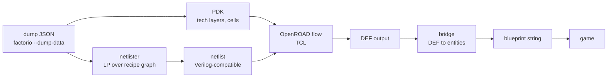

# factorilog

A Foundry PDK for Factorio. Place and route with OpenROAD, build with the
game's own blueprint format.

Factorio factories and IC designs share a shape:

| IC | Factorio |
| --- | --- |
| cell | building, specialized by recipe |
| cell library | the PDK: every (building, recipe) macro |
| routing layer | surface, underground tunnel pair, pipe run |
| layer change | one underground-belt or pipe-to-ground pair |
| track | belt, pipe, rail |
| power grid | pole and substation network |
| netlist | recipe graph, one wire per material |
| tape-out | blueprint exchange string |

## The flow



1.  Synthesis. The netlister reads the prototype dump and solves a linear
    program over the recipe graph. Demand in, recipe rates and machine
    counts out. This is the Yosys step of the flow.
2.  The PDK. One library of macros: footprint, ports, power, per
    (building, recipe). Layer stack: M1 surface, M2 tunnel pairs, M3
    fluids. Game-measured numbers: belt capacity, tunnel span, inserter
    reach, pole reach. No invented constants.
3.  Place and route. OpenROAD. The PDK speaks LEF and DEF, the flow runs
    as TCL, and the netlist is Verilog-compatible. This repo writes none
    of those algorithms.
4.  The bridge. DEF placement and routes become game entities. The
    blueprint codec is 40 lines: JSON, zlib, base64.

## Layout

| Path | Content |
| --- | --- |
| `foundry/solve.py` | The netlister. Recipe graph to LP to rates. |
| `foundry/pdk.py` | The tech layer: cells, layers, measured numbers. |
| `foundry/blueprint.py` | The exchange-string codec. |
| `foundry/netlist.py` | Plan to instances and nets. |
| `foundry/netbuild.py` | Dump and demand to `netlist.v` + sidecar. |
| `foundry/make_fixture.py` | Shrinks a real dump to the test fixture. |
| `foundry/test_solve.py` | Solver tests on the fixture. |
| `foundry/test_pdk.py` | Smoke test: dump to plan to cells to blueprint. |
| `reference/` | Prior art from the research phase. Not in the build. |
| `test/data/dump-fixture.json` | The hermetic dump subset. |
| `tools/` | STE linter, ruff, ty. |

## Use

```
bazel test //...                                  # the whole suite
bazel run //foundry:solve -- item electronic-circuit 3000 \
    --dump test/data/dump-fixture.json            # a plan
bazel run //foundry:solve -- tech rocket-silo 60 \
    --dump test/data/dump-fixture.json            # science for a run
bazel run //foundry:netbuild -- test/data/dump-fixture.json --spc 60
                                                  # netlist.v + sidecar
python3 foundry/make_fixture.py \
    ~/.factorio/script-output/data-raw-dump.json \
    test/data/dump-fixture.json                   # refresh the fixture
```

The fixture comes from one `factorio --dump-data` run. `bazel test` needs
no game and no network.

`netbuild` writes `foundry/netlist.v` and `foundry/netlist.json`. Both are
generated, so git ignores them: the Verilog feeds OpenROAD, the JSON
sidecar carries the rates and lane data that place-and-route reads.

## Status

Working: synthesis on the hermetic fixture. A 60 packs-per-minute demand
solves with zero balance error. The PDK reads cells and layer data. The
codec round-trips.

Next, in order: LEF/DEF writer from the PDK cells, OpenROAD flow skeleton,
DEF-to-entities bridge, trains as a track layer.

## Prose

All prose follows ASD-STE100. The linter runs as a pre-commit hook on the
added lines and on commit messages. Disable with `STE_LINT_DISABLE=1`.
