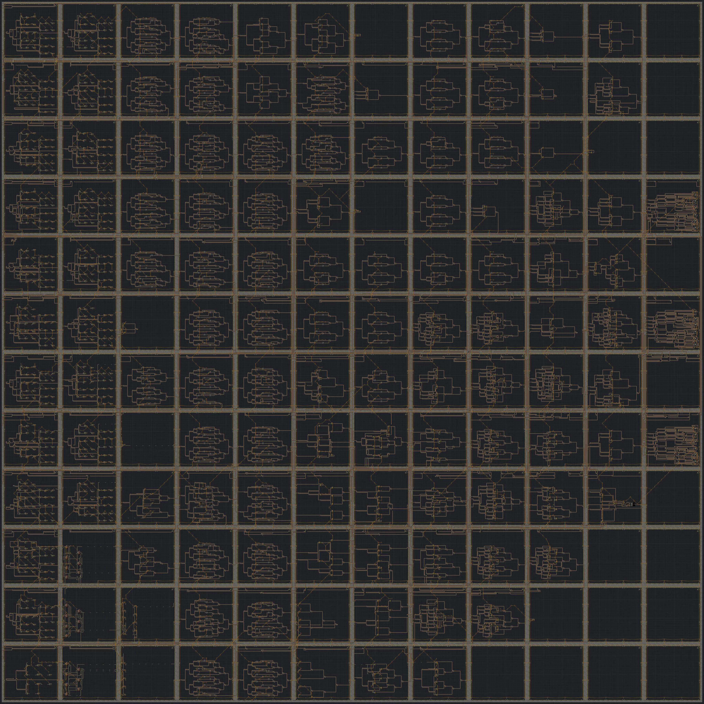
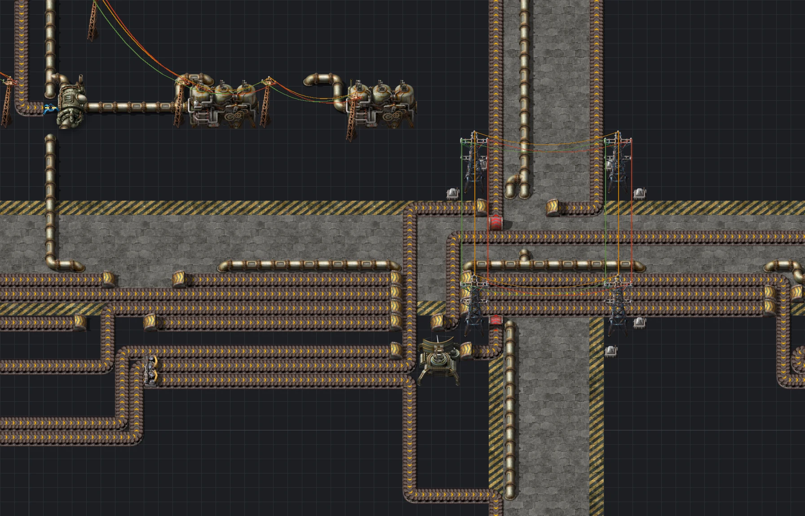
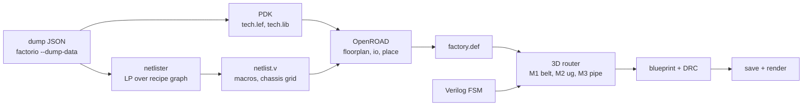
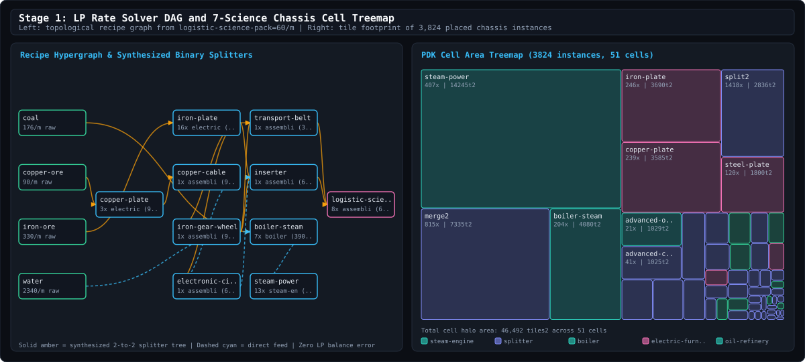
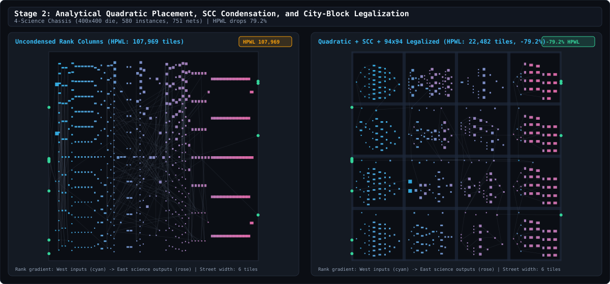
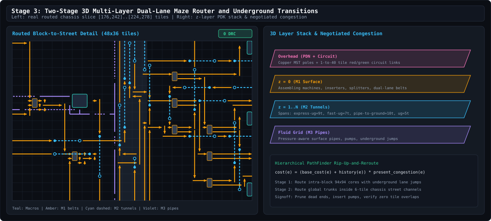
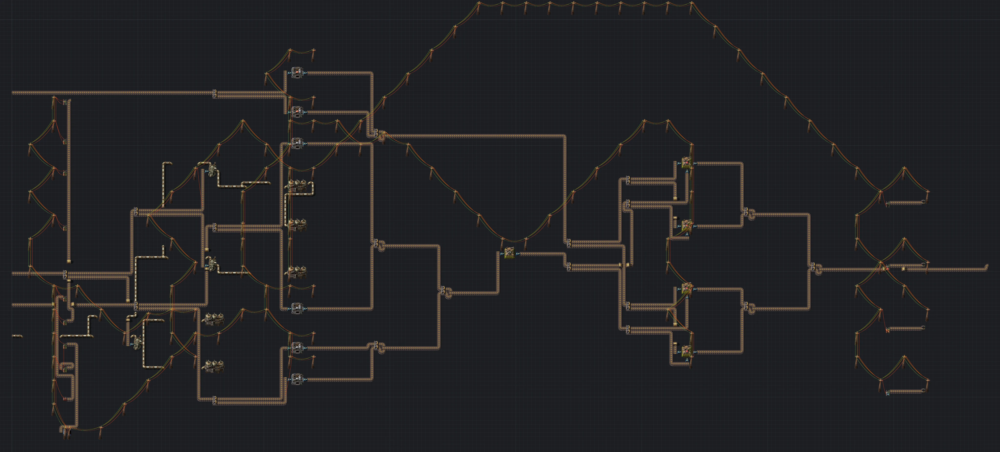
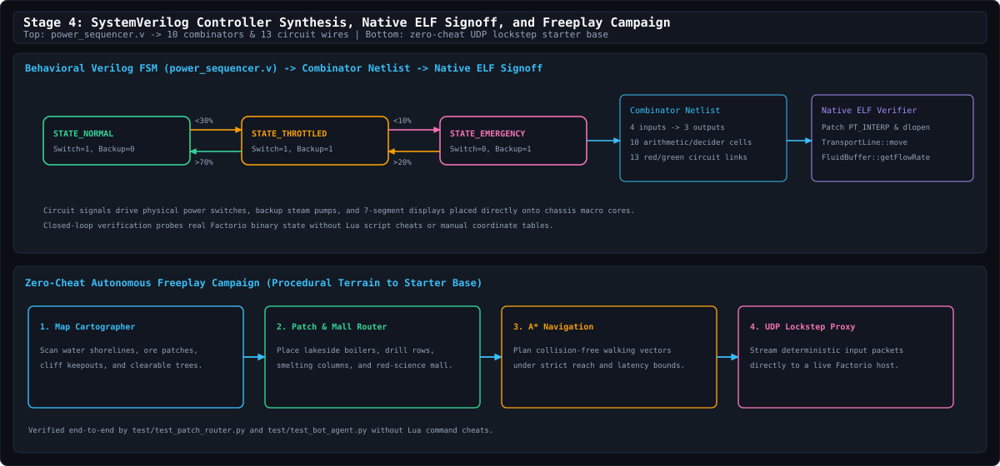
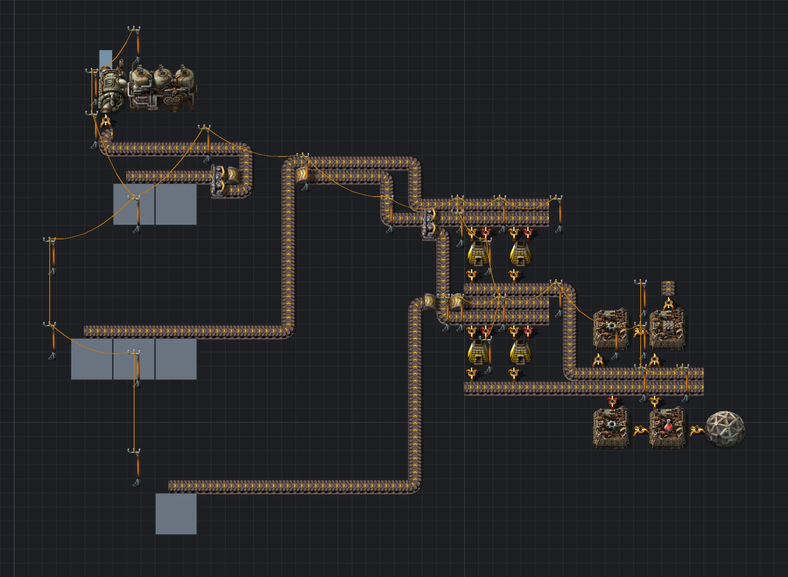

# factorilog

Factorilog compiles Factorio factories as digital integrated circuits. It links LP recipe synthesis, OpenROAD placement, and 3D maze routing.

Explore the compiled `1200x1200` die and scaling charts on the showcase page.

**[Interactive Die Explorer and Benchmarks](https://atvrager.github.io/factorilog/)**





Factorio factories match integrated circuits in structure and layout constraints.

| IC | Factorio |
| --- | --- |
| `cell` | `building` specialized by recipe |
| `cell library` | `PDK` containing each machine and recipe macro |
| `cell delay` | `energy_required / crafting_speed` craft time |
| `cell area` | `tile` footprint and material build cost |
| `capacitance` | belt load that a machine draws from feeds |
| `capacitor` | chest buffer sized by slots and stack limit |
| `routing layer` | `M1` surface belt, `M2` tunnel, `M3` pipe |
| `via` | underground belt or pipe-to-ground transition |
| `track` | `belt`, `pipe`, or `rail` |
| `RTL control` | SystemVerilog FSM lowered to combinators |
| `DRC and STA` | overlap check and native C++ ELF timing probe |
| `tape-out` | `blueprint` exchange string and save archive |

## The flow



1. **Synthesis.** `foundry/solve.py` solves a linear program over the recipe graph. Demand rates enter, and balanced machine counts exit.
2. **The PDK.** `foundry/pdk.py` measures Factorio prototypes at runtime. It extracts footprints, speeds, reaches, and fluid curves without hardcoded tables.
3. **Placement.** `foundry/analytical_placer.py` and OpenROAD arrange macros onto `100x100` city-block chassis tiles. Quadratic wirelength optimization compacts dense clusters before legalization.
4. **3D Routing.** `foundry/router/` executes PathFinder rip-up-and-reroute across three routing layers. `M1` carries surface belts, `M2` carries tunnels, and `M3` carries fluid pipes.
5. **RTL Control.** `foundry/circuit_synth.py` compiles SystemVerilog state machines into combinator circuits. Telemetry panels report belt starvation and hysteresis states in game ticks.
6. **Bridge and Verification.** `foundry/def2bp.py` lowers placed cells and routes into blueprint strings (`foundry/blueprint.py`). `foundry/native_engine/` runs DRC and C++ ELF timing probes against compiled binaries.
7. **Autonomous Bootstrap.** `foundry/patch_router.py` and `foundry/campaign/` construct Freeplay starter bases without console cheat commands.













## Benchmarks

Benchmarks measured at commit [`44b6c0f`](https://github.com/atvrager/factorilog/commit/44b6c0f0e55656296b50095cc8fb050f127a9fc3) (`2026-11-13`) on `AMD Ryzen 5 7600X 6-Core Processor`. Host hardware provides `6` physical cores and `12` logical threads. OpenROAD `pnr` uses `12` threads (`set_thread_count`). Python `synth`, Python `bp`, `render`, and `save` use `1` thread each.

| Target | Packs | Die | Macros | Cells | Entities | Wires | DRC | Synth | PnR | Route + BP | Total |
| --- | --- | --- | --- | --- | --- | --- | --- | --- | --- | --- | --- |
| `automation_science` | `1` | `202x120` | `38` | `9` | `1,642` | `159` | `0` | `0.5s` | `1.4s` | `2.3s` | `10.5s` |
| `automation_controlled_science` | `1` | `248x122` | `56` | `14` | `1,810` | `424` | `0` | `1.1s` | `1.0s` | `2.5s` | `11.2s` |
| `automation_science_chassis` | `1` | `300x300` | `46` | `9` | `2,503` | `755` | `0` | `0.9s` | `1.1s` | `2.1s` | `12.6s` |
| `automation_logistic_chassis` | `2` | `300x300` | `119` | `14` | `6,488` | `1,048` | `0` | `5.7s` | `0.8s` | `3.7s` | `17.9s` |
| `automation_logistic_military_chassis` | `3` | `300x300` | `244` | `21` | `11,386` | `1,284` | `0` | `6.2s` | `0.7s` | `6.3s` | `19.9s` |
| `automation_logistic_military_chemical_chassis` | `4` | `400x400` | `580` | `30` | `26,227` | `2,537` | `0` | `0.9s` | `0.3s` | `17.7s` | `25.8s` |
| `automation_logistic_military_chemical_production_chassis` | `5` | `700x700` | `1,521` | `35` | `68,224` | `7,679` | `0` | `7.2s` | `1.1s` | `27.0s` | `46.0s` |
| `automation_logistic_military_chemical_production_utility_chassis` | `6` | `900x900` | `2,439` | `43` | `116,339` | `12,359` | `0` | `16.1s` | `1.0s` | `104.4s` | `138.0s` |
| `science_chassis` | `7` | `1200x1200` | `3,824` | `51` | `188,786` | `20,153` | `0` | `111.2s` | `1.6s` | `86.6s` | `229.2s` |

The full provenance record and per-target timings live in [`site/data/benchmarks.json`](site/data/benchmarks.json).

## Layout

| Path | Content |
| --- | --- |
| `foundry/solve.py` | `LP` netlister converting recipe graphs into rates |
| `foundry/pdk.py` | Runtime prototype PDK layers, footprints, and capacities |
| `foundry/analytical_placer.py` | Quadratic wirelength optimization and SCC legalization |
| `foundry/chassis.py` | Hierarchical `100x100` city-block floorplan generator |
| `foundry/router/` | `3D` PathFinder maze router (`M1`, `M2`, `M3`) |
| `foundry/circuit_synth.py` | SystemVerilog FSM synthesis to combinator circuits |
| `foundry/def2bp.py` | `DEF` placement and routes lowered to blueprints |
| `foundry/native_engine/` | `dlopen` C++ binary verifier and timing probe |
| `foundry/campaign/` | Autonomous Freeplay bot agent and map cartographer |
| `foundry/patch_router.py` | Resource patch mining and smelt bootstrap layout |
| `foundry/render_bp.py` | Game-sprite PNG blueprint compositor |
| `flow/` | OpenROAD Tcl scripts, Bazel macros, and `power_sequencer.v` |
| `site/` | GitHub Pages bundle, die explorer, and `pages_bundle` |
| `test/data/dump-fixture.json` | Hermetic prototype dump subset |
| `tools/` | Showcase generator, STE linter, ruff, and ty checks |

## Use

```bash
bazel test //... --build_tests_only --test_tag_filters=-science,-openroad,-requires-game-data
bazel build //flow:automation_science_chassis_render
bazel build //site:pages_bundle
bazel run //tools:build_showcase_site -- --refresh-hermetic
bazel run //foundry:solve -- tech rocket-silo 60 --dump test/data/dump-fixture.json
./flow/orfs.sh
python3 foundry/make_fixture.py ~/.factorio/script-output/data-raw-dump.json test/data/dump-fixture.json
```

The hermetic test suite needs no Factorio installation and no network access.

## Regenerating the PDK

Two inputs feed one command. A new Factorio version reruns both.

1. `factorio --dump-data` writes the prototype dump. Nearly all PDK constants come from here, such as footprints, speeds, spans, and reaches.
2. The probe mod measures pipe-to-ground length flow, inserter swing throughput, and fluid curves.
3. `bazel run //foundry:netbuild` merges both inputs into `tech.lef`, `tech.lib`, and `netlist.v`.

The OpenROAD stage runs inside the `openroad/orfs` container image:

```bash
./flow/orfs.sh
```

## Prose

All prose follows ASD-STE100. The pre-commit hook runs `tools/ste-lint.py` on added lines and commit messages. Override the check with `STE_LINT_DISABLE=1`.
