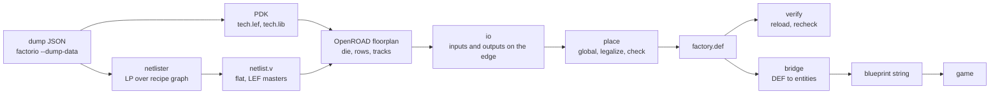

# factorilog

A Foundry PDK for Factorio. Place and route with OpenROAD, build with the
game's own blueprint format.

Factorio factories and IC designs share a shape:

| IC | Factorio |
| --- | --- |
| cell | building, specialized by recipe |
| cell library | the PDK: every (building, recipe) macro |
| cell delay | craft time: energy_required over crafting_speed |
| cell area | tile footprint, and one day the material build cost |
| capacitance | the load a machine puts on its feed belt |
| capacitor | a chest: capacity in slots times stack size |
| routing layer | surface, underground tunnel pair, pipe run |
| layer change | one underground-belt or pipe-to-ground pair |
| track | belt, pipe, rail |
| corners | beacon and module settings: no beacons is the slow corner |
| power grid | pole and substation network |
| netlist | recipe graph, one wire per material |
| tape-out | blueprint exchange string |

## The flow



1.  Synthesis. The netlister reads the prototype dump and solves a linear
    program over the recipe graph. Demand in, recipe rates and machine
    counts out. This is the Yosys step of the flow.
2.  The PDK. One library of macros: footprint, ports, power, timing, per
    (building, recipe). Layer stack: M1 surface, M2 tunnel pairs, M3
    fluids. Game-measured numbers: belt capacity, tunnel span, inserter
    reach, pole reach. No invented constants.
3.  Floorplan, io, place. OpenROAD. The die holds the block area at 28
    percent fill, the rows sit on the tile grid, and legalization keeps
    a two tile lane between block columns, enough for one belt and one
    inserter. The placement check is fatal on any violation.
4.  Verify. The flow reads `factory.def` back and repeats the checks, so
    the bridge never consumes a file OpenROAD cannot reload.
5.  Route. Not yet. The next stage: belts, tunnels, and pipes on the
    three layers.
6.  The bridge. DEF placement and routes become game entities. The
    blueprint codec is 40 lines: JSON, zlib, base64.

## Layout

| Path | Content |
| --- | --- |
| `foundry/solve.py` | The netlister. Recipe graph to LP to rates. |
| `foundry/pdk.py` | The tech layer: cells, layers, measured numbers. |
| `foundry/blueprint.py` | The exchange-string codec. |
| `foundry/netlist.py` | Plan to instances and nets, flat Verilog, cell stubs. |
| `foundry/lef.py` | LEF writer: macros, layers, vias, checker. |
| `foundry/liberty.py` | Liberty stubs: area, pins, power, timing arcs. |
| `foundry/netbuild.py` | Dump and demand to `netlist.v`, `cells.v`, `tech.lef`, `tech.lib`. |
| `flow/factorilog.tcl` | The OpenROAD stages: floorplan, io, place, write DEF. |
| `flow/verify_def.tcl` | Reads the DEF back and repeats the checks. |
| `flow/orfs.sh` | Runs a stage in the `openroad/orfs` Podman container. |
| `foundry/make_fixture.py` | Shrinks a real dump to the test fixture. |
| `foundry/test_solve.py` | Solver tests on the fixture. |
| `foundry/test_pdk.py` | Smoke test: dump to plan to cells to blueprint. |
| `reference/` | Prior art from the research phase. Not in the build. |
| `test/data/dump-fixture.json` | The hermetic dump subset. |
| `tools/` | STE linter, ruff, ty. |

## Use

```
bazel test //...                                  # the whole suite
bazel run //foundry:solve -- item electronic-circuit 3000 \
    --dump test/data/dump-fixture.json            # a plan
bazel run //foundry:solve -- tech rocket-silo 60 \
    --dump test/data/dump-fixture.json            # science for a run
bazel run //foundry:netbuild -- test/data/dump-fixture.json --spc 60
                                                  # netlist.v + sidecar
flow/orfs.sh                        # floorplan, io, place
flow/orfs.sh flow/verify_def.tcl    # read the DEF back
python3 foundry/make_fixture.py \
    ~/.factorio/script-output/data-raw-dump.json \
    test/data/dump-fixture.json                   # refresh the fixture
```

The fixture comes from one `factorio --dump-data` run. `bazel test` needs
no game and no network.

`netbuild` writes `foundry/netlist.v`, `foundry/cells.v`, `foundry/tech.lef`,
and `foundry/tech.lib`. Git ignores all of them. The Verilog feeds
OpenROAD, the LEF holds the masters, the Liberty stubs hold the timing
view, and the JSON sidecar carries the rates and lane data that
place-and-route reads.

## Regenerating the PDK

Two inputs feed one command. A new game version reruns both.

1.  `factorio --dump-data` writes the prototype dump. Nearly every PDK
    number comes from here: footprints, belt speeds, tunnel spans, pole
    reach, machine speed and power, splitter geometry.
2.  The probe mod measures the four numbers the dump lacks. Those are
    the pipe-to-ground span, the inserter swing rate under load, fluid
    flow against pipe length, and train acceleration. They live in one
    measurements file with a game version stamp.
3.  `bazel run //foundry:netbuild` merges the two and writes the PDK and
    the netlist. The PDK is a build product, never a hand-edited file.

The OpenROAD stage runs in the prebuilt `openroad/orfs` Podman container,
no build step:

```
flow/orfs.sh    # read_liberty, read_lef, read_verilog, link, place, route
```

## Status

Working: synthesis, placement, routing, and static timing analysis
on the hermetic fixture. A 60 packs-per-minute demand solves with zero
balance error and lowers to a flat netlist: 1220 instances, 1248 nets, 12
ports. The PDK carries 39 masters with LEF geometry and Liberty timing
arcs based on recipe craft duration. OpenROAD places all 1220 blocks on
the tile grid with no overlap. FastRoute and TritonRoute route all nets
across three layers with zero DRC violations. OpenSTA reports critical
path timing and slack across the full combinational factory.

Next: the DEF-to-entities bridge with blueprint strings, and trains as a
track layer.

## Prose

All prose follows ASD-STE100. The linter runs as a pre-commit hook on the
added lines and on commit messages. Disable with `STE_LINT_DISABLE=1`.
