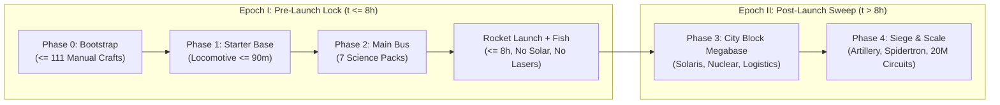
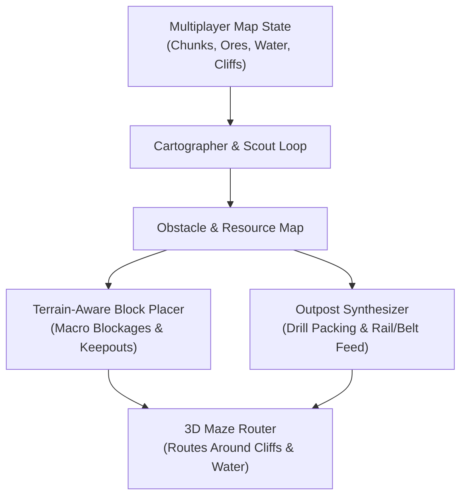
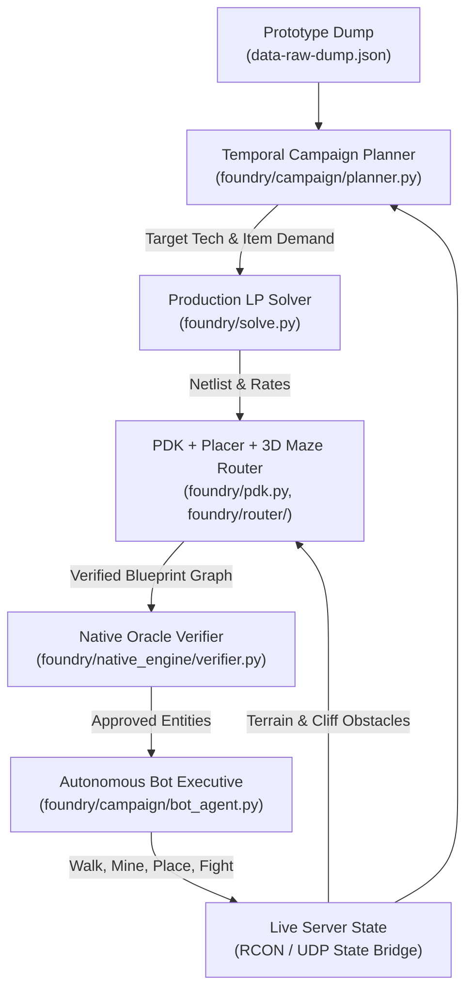

# Autonomous Campaign Solver & Phased Base Architecture Specification

## 1. Executive Summary & North Star Objective

This document specifies the **Autonomous Campaign Solver & Phased Base Architecture** for [`factorilog`](file:///home/atv/src/factorilog).

### 1.1 The North Star Goal
The system achieves all 59 vanilla Factorio base-game achievements in one continuous campaign on an unmodded multiplayer server. The system connects an autonomous bot client to the server and executes every physical action without human intervention. It mines raw resources, navigates water and cliffs, and researches the technology tree. It also defends against hostile biters and scales production through a rocket launch and megabase targets.

### 1.2 Core Design Constraints
1. **Zero Game Modification and Full Autonomy**.
   - The server runs vanilla Factorio with default achievement rules and zero script cheats.
   - The autonomous bot client connects over the multiplayer protocol.
   - The bot performs all movement, mining, placement, logistics, and combat actions.
2. **Dynamic Prototype Ground Truth**.
   - The solver reads recipes, technologies, dimensions, speeds, spans, pollution values, and achievement rules from the prototype dump.
   - This logic builds on [`solve.py`](file:///home/atv/src/factorilog/foundry/solve.py) and [`pdk.py`](file:///home/atv/src/factorilog/foundry/pdk.py).
   - The codebase forbids hardcoded prototype constants and excludes Space Age expansion prototypes.
3. **Seed-Agnostic Terrain Adaptation**.
   - The system starts with only the spawn area visible.
   - The bot explores unknown chunks and maps finite ore patches, water bodies, trees, and cliffs.
   - The floorplanner adapts the physical layout to the discovered terrain.
4. **In-Place Phased Expansion**.
   - The floorplanner reserves a master coordinate grid at game start.
   - Early stages (Bootstrap, Starter Base, and Main Bus Base) sit within reserved sectors of the master grid.
   - Phase 3 (City Block Megabase) expands around and upgrades early sectors in place without tearing down the core factory.
5. **Single-Run Achievement Sweep**.
   - A temporal solver divides the campaign into two macro-epochs.
   - **Epoch I (Pre-Launch Lock)** enforces all mutually restrictive and timed achievements up to the 8-hour rocket launch.
   - **Epoch II (Post-Launch Sweep)** lifts the pre-launch locks to complete power, logistic, combat, and scale achievements on the same map.

---

## 2. Base-Game Achievement Taxonomy & Temporal Partitioning

The solver extracts all 59 achievement definitions from [`achievements.lua`](file:///home/atv/.steam/steam/steamapps/common/Factorio/data/base/prototypes/achievements.lua) at runtime and partitions them into two sequential epochs. (The expansion file `data/space-age/prototypes/achievements.lua` defines 29 additional achievements, which this base-game flow excludes.)



### 2.1 Hard Invariant Locks (Epoch I: $t = 0$ to Rocket Launch)
Four achievements impose strict negative constraints on the entire run until the rocket launches.

| Achievement Prototype | Type | Physical Constraint | Solver Enforcement |
|:---|:---|:---|:---|
| `lazy-bastard` | `dont-craft-manually-achievement` | `amount = 111`, `objective_condition = "rocket-launched"`. | Caps the player hand-crafting queue. Reserves 106 mandatory crafts to reach the first `assembling-machine-1`. |
| `there-is-no-spoon` | `complete-objective-achievement` | `within = 8 * hour` ($1,728,000$ ticks), `allowed_without_fight = false`. | Temporal scheduler budgets tick deadlines per technology and base phase. |
| `steam-all-the-way` | `dont-use-entity-in-energy-production-achievement` | `excluded = "solar-panel"`, `allowed_without_fight = false`. | Excludes `solar-panel` from the PDN synthesis library during Epoch I. |
| `raining-bullets` | `dont-build-entity-achievement` | `dont_build = "laser-turret"`, `allowed_without_fight = false`. | Restricts defense macros to kinetic (`gun-turret`) and fluid (`flamethrower-turret`) cells during Epoch I. |

### 2.2 Cross-Epoch Locks (Until Specific Trigger)
Two achievements restrict actions beyond or independent of the rocket launch.

| Achievement Prototype | Type | Trigger Condition | Solver Enforcement |
|:---|:---|:---|:---|
| `logistic-network-embargo` | `dont-build-entity-achievement` | `objective_condition = "late-research"`, `research_with = {"space-science-pack"}`, `dont_build = {"active-provider-chest", "requester-chest", "buffer-chest"}`. | Locks active, requester, and buffer chests until the first space-science research finishes. Permits `passive-provider-chest` and `storage-chest`. |
| `keeping-your-hands-clean` | `dont-kill-manually-achievement` | `type_not_to_kill = "unit-spawner"`, `allowed_without_fight = false`. Locale requires destroying the first enemy structure with artillery. | Prohibits spawner kills until `artillery-turret` or `artillery-wagon` destroys the first `biter-spawner` or `spitter-spawner`. This simultaneously unlocks `pest-control` and `art-of-siege`. |

### 2.3 Complete 59-Achievement Ground-Truth Catalog
Every prototype below loads directly from `data/base/prototypes/achievements.lua`:

| # | Prototype Name | Prototype Type | Order Group | Ground-Truth Condition | Target Phase |
|:---|:---|:---|:---|:---|:---|
| 1 | `automate-this` | `build-entity-achievement` | `a[progress]` | `to_build = "assembling-machine-1"` | Phase 0 |
| 2 | `getting-on-track` | `build-entity-achievement` | `a[progress]` | `to_build = "locomotive"` | Phase 1 |
| 3 | `arachnophilia` | `build-entity-achievement` | `a[progress]` | `to_build = "spidertron"` | Phase 3 |
| 4 | `eco-unfriendly` | `research-achievement` | `a[progress]` | `technology = "oil-processing"` | Phase 2 |
| 5 | `steam-power` | `use-entity-in-energy-production-achievement` | `a[progress]` | `entity = "steam-engine"` | Phase 0 |
| 6 | `solar-power` | `use-entity-in-energy-production-achievement` | `a[progress]` | `entity = "solar-panel"` | Phase 3 |
| 7 | `nuclear-power` | `use-entity-in-energy-production-achievement` | `a[progress]` | `entity = "steam-turbine"`, `required_to_build = "nuclear-reactor"`, `consumed_condition = "uranium-fuel-cell"`, `produced_condition = "depleted-uranium-fuel-cell"` | Phase 3 |
| 8 | `crafting-with-speed` | `produce-achievement` | `a[progress]` | `item_product = "speed-module-3"`, `amount = 1` | Phase 3 |
| 9 | `crafting-with-efficiency` | `produce-achievement` | `a[progress]` | `item_product = "efficiency-module-3"`, `amount = 1` | Phase 3 |
| 10 | `crafting-with-productivity` | `produce-achievement` | `a[progress]` | `item_product = "productivity-module-3"`, `amount = 1` | Phase 3 |
| 11 | `smoke-me-a-kipper-i-will-be-back-for-breakfast` | `complete-objective-achievement` | `a[progress]` | `objective_condition = "rocket-launched"` | Phase 2 |
| 12 | `it-stinks-and-they-dont-like-it` | `group-attack-achievement` | `b[exploration]` | `attack_type = "autonomous"`, `amount = 1`, `allowed_without_fight = false` | Phase 1 |
| 13 | `automated-construction` | `construct-with-robots-achievement` | `b[exploration]` | `amount = 100`, `limited_to_one_game = false` | Phase 2 |
| 14 | `you-are-doing-it-right` | `construct-with-robots-achievement` | `b[exploration]` | `more_than_manually = true`, `limited_to_one_game = true` | Phase 2 |
| 15 | `automated-cleanup` | `deconstruct-with-robots-achievement` | `b[exploration]` | `amount = 100` | Phase 2 |
| 16 | `you-have-got-a-package` | `deliver-by-robots-achievement` | `b[exploration]` | `amount = 1` | Phase 3 |
| 17 | `delivery-service` | `deliver-by-robots-achievement` | `b[exploration]` | `amount = 10000` | Phase 3 |
| 18 | `trans-factorio-express` | `train-path-achievement` | `b[exploration]` | `minimum_distance = 1000` | Phase 3 |
| 19 | `watch-your-step` | `player-damaged-achievement` | `b[exploration]` | `type_of_dealer = "locomotive"`, `minimum_damage = 0`, `should_survive = false` | Phase 3 |
| 20 | `golem` | `player-damaged-achievement` | `b[exploration]` | `minimum_damage = 500`, `should_survive = true` | Phase 3 |
| 21 | `mining-with-determination` | `deplete-resource-achievement` | `b[exploration]` | Completely deplete one resource patch | Phase 2 |
| 22 | `getting-on-track-like-a-pro` | `build-entity-achievement` | `c[teaching]` | `to_build = "locomotive"`, `within = 90 * minute` | Phase 1 |
| 23 | `mass-production-1` | `produce-achievement` | `d[production]` | `item_product = "electronic-circuit"`, `amount = 10000` | Phase 2 |
| 24 | `mass-production-2` | `produce-achievement` | `d[production]` | `item_product = "electronic-circuit"`, `amount = 1000000` | Phase 3 |
| 25 | `mass-production-3` | `produce-achievement` | `d[production]` | `item_product = "electronic-circuit"`, `amount = 20000000` | Phase 3 |
| 26 | `circuit-veteran-1` | `produce-per-hour-achievement` | `d[production]` | `item_product = "advanced-circuit"`, `amount = 1000` | Phase 2 |
| 27 | `circuit-veteran-2` | `produce-per-hour-achievement` | `d[production]` | `item_product = "advanced-circuit"`, `amount = 10000` | Phase 3 |
| 28 | `circuit-veteran-3` | `produce-per-hour-achievement` | `d[production]` | `item_product = "advanced-circuit"`, `amount = 25000` | Phase 3 |
| 29 | `computer-age-1` | `produce-per-hour-achievement` | `d[production]` | `item_product = "processing-unit"`, `amount = 500` | Phase 2 |
| 30 | `computer-age-2` | `produce-per-hour-achievement` | `d[production]` | `item_product = "processing-unit"`, `amount = 1000` | Phase 3 |
| 31 | `computer-age-3` | `produce-per-hour-achievement` | `d[production]` | `item_product = "processing-unit"`, `amount = 5000` | Phase 3 |
| 32 | `iron-throne-1` | `produce-per-hour-achievement` | `d[production]` | `item_product = "iron-plate"`, `amount = 20000` | Phase 2 |
| 33 | `iron-throne-2` | `produce-per-hour-achievement` | `d[production]` | `item_product = "iron-plate"`, `amount = 200000` | Phase 3 |
| 34 | `iron-throne-3` | `produce-per-hour-achievement` | `d[production]` | `item_product = "iron-plate"`, `amount = 400000` | Phase 3 |
| 35 | `solaris` | `dont-use-entity-in-energy-production-achievement` | `d[production]` | `included = "solar-panel"`, `excluded = {"steam-engine", "steam-turbine"}`, `minimum_energy_produced = "10GJ"`, `last_hour_only = true` | Phase 3 |
| 36 | `research-with-automation` | `research-with-science-pack-achievement` | `e[research]` | `science_pack = "automation-science-pack"` | Phase 0 |
| 37 | `research-with-logistics` | `research-with-science-pack-achievement` | `e[research]` | `science_pack = "logistic-science-pack"` | Phase 1 |
| 38 | `research-with-military` | `research-with-science-pack-achievement` | `e[research]` | `science_pack = "military-science-pack"` | Phase 2 |
| 39 | `research-with-chemicals` | `research-with-science-pack-achievement` | `e[research]` | `science_pack = "chemical-science-pack"` | Phase 2 |
| 40 | `research-with-production` | `research-with-science-pack-achievement` | `e[research]` | `science_pack = "production-science-pack"` | Phase 2 |
| 41 | `research-with-utility` | `research-with-science-pack-achievement` | `e[research]` | `science_pack = "utility-science-pack"` | Phase 2 |
| 42 | `research-with-space` | `research-with-science-pack-achievement` | `e[research]` | `science_pack = "space-science-pack"` | Phase 2 |
| 43 | `tech-maniac` | `research-achievement` | `e[research]` | `research_all = true` | Phase 3 |
| 44 | `pest-control` | `kill-achievement` | `f[kill]` | `to_kill = {"biter-spawner", "spitter-spawner"}`, `amount = 1`, `personally = false` | Phase 3 |
| 45 | `steamrolled` | `kill-achievement` | `f[kill]` | `type_to_kill = "unit-spawner"`, `damage_type = "impact"`, `in_vehicle = true`, `personally = true`, `amount = 10` | Phase 3 |
| 46 | `pyromaniac` | `kill-achievement` | `f[kill]` | `type_to_kill = "tree"`, `damage_type = "fire"`, `amount = 10000` | Phase 3 |
| 47 | `run-forrest-run` | `kill-achievement` | `f[kill]` | `type_to_kill = "tree"`, `damage_type = "impact"`, `in_vehicle = true`, `personally = true`, `amount = 100` | Phase 3 |
| 48 | `terraformer` | `destroy-cliff-achievement` | `f[kill]` | Destroy a cliff (`cliff-explosives`) | Phase 2 |
| 49 | `destroyer-of-worlds` | `shoot-achievement` | `f[kill]` | `ammo_type = "atomic-bomb"`, `amount = 1` | Phase 3 |
| 50 | `minions` | `combat-robot-count-achievement` | `f[kill]` | `count = 100` | Phase 3 |
| 51 | `art-of-siege` | `kill-achievement` | `f[kill]` | `type_to_kill = "unit-spawner"`, `damage_dealer = {"artillery-turret", "artillery-wagon"}`, `amount = 1` | Phase 3 |
| 52 | `keeping-your-hands-clean` | `dont-kill-manually-achievement` | `f[kill]` | `type_not_to_kill = "unit-spawner"`, `allowed_without_fight = false` | Phase 3 |
| 53 | `lazy-bastard` | `dont-craft-manually-achievement` | `h[limitation]` | `amount = 111`, `objective_condition = "rocket-launched"` | Phase 2 |
| 54 | `steam-all-the-way` | `dont-use-entity-in-energy-production-achievement` | `h[limitation]` | `excluded = "solar-panel"`, `objective_condition = "rocket-launched"`, `allowed_without_fight = false` | Phase 2 |
| 55 | `raining-bullets` | `dont-build-entity-achievement` | `h[limitation]` | `dont_build = "laser-turret"`, `objective_condition = "rocket-launched"`, `allowed_without_fight = false` | Phase 2 |
| 56 | `logistic-network-embargo` | `dont-build-entity-achievement` | `h[limitation]` | `dont_build = {"active-provider-chest", "requester-chest", "buffer-chest"}`, `objective_condition = "late-research"`, `research_with = {"space-science-pack"}` | Phase 2 |
| 57 | `no-time-for-chitchat` | `complete-objective-achievement` | `h[limitation]` | `within = 15 * hour`, `objective_condition = "rocket-launched"`, `allowed_without_fight = false` | Phase 2 |
| 58 | `there-is-no-spoon` | `complete-objective-achievement` | `h[limitation]` | `within = 8 * hour`, `objective_condition = "rocket-launched"`, `allowed_without_fight = false` | Phase 2 |
| 59 | `so-long-and-thanks-for-all-the-fish` | `achievement` | `h[secret]` | Launch a rocket with `raw-fish` inserted | Phase 2 |

---

## 3. Master Grid & In-Place Phased Base Architecture

The floorplanner establishes a unified **Master Chassis Grid** anchored at the spawn origin $(0, 0)$ (see [`chassis_layout_architecture.md`](file:///home/atv/src/factorilog/docs/chassis_layout_architecture.md)). Each $100 \times 100$ tile city block ($94 \times 94$ core with 6-tile streets) receives a phase role.

```
+-----------------------+-----------------------+-----------------------+
|   Block (-1, 1)       |   Block (0, 1)        |   Block (1, 1)        |
|   Phase 2: Fluid &    |   Phase 2: Main Bus   |   Phase 2: Science    |
|   Refinery Wing       |   Spine (North)       |   & Lab Core          |
+=======================#=======================#=======================+
|   Block (-1, 0)       |   Block (0, 0)        |   Block (1, 0)        |
|   Phase 1: Smelting   |   Phase 0 & 1:        |   Phase 2: Main Bus   |
|   Columns             |   Bootstrap & Mall    |   Spine (East)        |
+=======================#=======================#=======================+
|   Block (-1, -1)      |   Block (0, -1)       |   Block (1, -1)       |
|   Phase 1: Steam      |   Phase 1: Rail Yard  |   Phase 3: Rocket     |
|   Power Plant         |   (90m Locomotive)    |   Silo & Space Block  |
+-----------------------+-----------------------+-----------------------+
```

### 3.1 Phase 0: The 111-Craft Bootstrap (0 to 15 Minutes)
- **Footprint**: Occupies the center of Block $(0, 0)$ near the starting resource patches.
- **Objective**: Unlock `automation` and place the first `assembling-machine-1` using $\le 106$ manual crafts (`lazy-bastard`).
- **Execution**:
  1. The bot harvests starting coal, iron, stone, and wood.
  2. The bot places burner mining drills feeding `stone-furnace` pairs directly.
  3. The bot crafts one `offshore-pump`, one `boiler`, one `steam-engine`, one `lab`, and 10 `automation-science-pack` items by hand.
  4. Once `automation` finishes, `assembling-machine-1` cells manufacture all subsequent gears, circuits, inserters, belts, and machines.
  5. Manual crafting locks permanently through server permissions or the bot guard.

### 3.2 Phase 1: Starter Base & 90-Minute Rail Milestone (15 to 90 Minutes)
- **Footprint**: Expands across Block $(0, 0)$ (Mall), Block $(-1, 0)$ (Smelting), and Block $(-1, -1)$ (Steam Power).
- **Objective**: Automate `automation-science-pack` and `logistic-science-pack`, build a self-expanding mall, and construct a `locomotive` in Block $(0, -1)$ within 90 minutes.
- **In-Place Design**:
  - Smelting arrays in Block $(-1, 0)$ align with the 6-tile street boundaries.
  - Their output belts feed directly into the Phase 2 Main Bus spine without relocation.
  - The mall in Block $(0, 0)$ produces belts, undergrounds, splitters, inserters, assemblers, drills, pipes, and gun turrets.

### 3.3 Phase 2: Main Bus Base & 8-Hour Rocket Launch (1.5 to 8 Hours)
- **Footprint**: Extends along the primary axis through Blocks $(1, 0)$, $(2, 0)$, $(0, 1)$, and $(1, 1)$. Block $(-1, 1)$ hosts oil refineries and chemical plants, and Block $(1, -1)$ hosts the `rocket-silo`.
- **Objective**: Synthesize military, chemical, production, and utility science at rates solved through [`solve.py`](file:///home/atv/src/factorilog/foundry/solve.py). Launch a fish-carrying rocket within 8 hours (`there-is-no-spoon`) and finish the first `space-science-pack` technology (`logistic-network-embargo`).
- **In-Place Design**:
  - The 6-tile chassis streets between blocks carry the main bus lanes, routed by the 3D multi-layer maze router ([`native_router_architecture.md`](file:///home/atv/src/factorilog/docs/native_router_architecture.md)).
  - As technology advances, the bot upgrades yellow belts to red belts, `stone-furnace` to `steel-furnace`, and `assembling-machine-1` to `assembling-machine-2` in place.
  - These upgrades require zero rerouting because the tiers share identical tile footprints in the PDK ([`factorio_pdk_architecture.md`](file:///home/atv/src/factorilog/docs/factorio_pdk_architecture.md)).
  - Construction bots (`roboport`, `passive-provider-chest`, and `storage-chest`) come online during chemical science to stamp blueprints while respecting `logistic-network-embargo`.

### 3.4 Phase 3: City Block Megabase & Achievement Sweep (Post-8 Hours)
- **Footprint**: Tiles outward across the $100 \times 100$ chassis grid, linked by a 1,000+ tile rail network.
- **Objective**: Scale production to $400\text{k}$ `iron-plate`/hr, $25\text{k}$ `advanced-circuit`/hr, $5\text{k}$ `processing-unit`/hr, and $20\text{M}$ cumulative `electronic-circuit` items. Complete all power, combat, and demolition achievements in parallel.
- **In-Place Upgrade**:
  - The Phase 1 and Phase 2 blocks remain active as the central mall and bootstrap hub.
  - Dedicated city blocks instantiate high-density `assembling-machine-3` and `electric-furnace` cores surrounded by `beacon` rows (`speed-module-3` and `productivity-module-3`).

---

## 4. Seed-Agnostic Exploration, Terrain Obstacles, and Resource Binding

A real multiplayer map contains unknown fog-of-war, irregular ore patches, lakes, forests, and cliffs. The campaign architecture bridges the gap between idealized EDA floorplans and organic map geometry.



### 4.1 Autonomous Scouting & Cartography Loop
1. **Initial Survey**: At $t = 0$, the bot scans charted chunks to find iron, copper, coal, stone, and water.
2. **Radar Sweep**: The chassis places `radar` entities at block corners ([`chassis_layout_architecture.md`](file:///home/atv/src/factorilog/docs/chassis_layout_architecture.md)). Each radar charts nearby sectors and periodically reveals distant chunks.
3. **Active Reconnaissance**: The solver triggers reconnaissance when a phase requires undiscovered `crude-oil`, `uranium-ore`, or secondary ore patches. The bot drives a vehicle or walks along a spiral frontier until the required resource prototypes enter charted space.

### 4.2 Handling Terrain Obstacles (Cliffs, Water, and Trees)
1. **Trees and Rocks (Clearable Obstacles)**.
   - Trees and rocks inside a target block footprint do not block placement permanently.
   - Before construction bots unlock, the bot clears only the exact tile coordinates required for entities and belts.
   - After construction bots unlock, blueprint placement automatically flags colliding trees and rocks for robot deconstruction (`automated-cleanup`).
   - Dense forests outside the base remain standing to absorb pollution until Phase 4 targets them for `pyromaniac` and `run-forrest-run`.
2. **Cliffs (Hard Keepouts until Cliff Explosives)**.
   - Before `cliff-explosives` unlock, the Cartographer queries every cliff collision box from the prototype data.
   - It marks each cliff as a surface blockage ($z = 0$) in OpenROAD DEF and the 3D router grid ([`foundry/router/grid.py`](file:///home/atv/src/factorilog/foundry/router/grid.py)).
   - Subterranean layers ($z \ge 1$) tunnel underneath cliffs wherever the cliff width fits within the dynamic prototype `max_distance` span.
   - Once chemical science unlocks `cliff-explosives`, the bot demolishes obstructing cliffs (`terraformer`) and reclaims the blocked tiles.
3. **Water Bodies (Source Pin & Hard Obstacle until Landfill)**.
   - Water tiles act as required placement anchors for `offshore-pump` macros and as hard keepout zones for land entities.
   - If water intersects a critical block or street, the solver synthesizes `landfill` from stone and paves the tiles before placement.

### 4.3 Dynamic Ore Patch & Fluid Outpost Synthesis
Mining drills and pumpjacks must bind to the exact coordinates where map generation placed resources.
1. **Miner Packing Solver**.
   - The Outpost Synthesizer reads the resource tile coordinates $(x_i, y_i)$ and the drill prototype `mining_drill_radius` and `collision_box`.
   - It packs drills to maximize extraction rate and achieves full patch coverage for `mining-with-determination`.
   - Output lanes merge through dynamically synthesized compound belt balancers (`belt_split2` networks) onto outbound bus belts or train loading stations.
2. **Pumpjack Manifold Router**.
   - Given discrete `crude-oil` coordinates, the synthesizer places `pumpjack` macros aligned to their fluid output pins.
   - The 3D multi-layer pipe router connects all well outputs into storage tanks and fluid wagons.

---

## 5. Threat, Pollution, and Military Solver

Biters provide the primary external pressure on the factory. A configuration flag can disable biters for isolated layout debugging. Full achievement runs keep biters active to satisfy `it-stinks-and-they-dont-like-it`, `pest-control`, `keeping-your-hands-clean`, `raining-bullets`, `art-of-siege`, and `steamrolled`.

### 5.1 Pollution Cloud & Evolution Modeling
The solver models pollution and biter evolution at runtime from prototype parameters.
1. **Emissions Budget**.
   - Every machine prototype defines `emissions_per_minute` in its `energy_source`, modified by recipe pollution multipliers and modules.
   - Boilers, burner drills, stone/steel furnaces, and electric mining drills generate the majority of early-game pollution.
2. **Absorption & Spawner Trigger**.
   - Each chunk absorbs pollution according to tile type and tree density.
   - When the pollution cloud reaches a `biter-spawner` or `spitter-spawner`, the spawner absorbs pollution and dispatches attack waves (`it-stinks-and-they-dont-like-it`).
3. **Evolution Factor**.
   - The solver tracks time, total pollution, and spawner kills to predict transitions from `small-biter` to `behemoth-biter`.
   - During Epoch I, the bot avoids unnecessary spawner kills because spawner kills spike evolution and risk violating `keeping-your-hands-clean`.
   - The bot inserts `efficiency-module` items into outlying mining drills whenever pollution pressure exceeds ammo production capacity.

### 5.2 Automated Perimeter Defense Synthesis
To satisfy `raining-bullets` and `keeping-your-hands-clean`, all Epoch I defense uses kinetic and flame weapons.
1. **Early Pillbox Macros (Phase 1)**.
   - Automated `gun-turret` clusters receive `firearm-magazine` or `piercing-rounds-magazine` items from a belt loop along pollution-exposed avenues.
2. **Bastion Wall Chassis (Phase 2)**.
   - Each perimeter segment macro places a double `stone-wall` barrier, a belt-fed `gun-turret` line, and a pipe-fed `flamethrower-turret` line.
   - Perimeter roboports supply `repair-pack` items to maintain the wall.
   - During Epoch I, the bot places defensive walls outside spawner aggro range so no turret destroys a spawner before `artillery` unlocks.
   - This standoff distance preserves `keeping-your-hands-clean` ("Destroy your first enemy structure using artillery").

### 5.3 Epoch II Offensive Siege & Combat Sweep
Once the rocket launches and `artillery` unlocks:
1. **Artillery Siege (`art-of-siege` & `keeping-your-hands-clean`)**.
   - The bot constructs an `artillery-turret` (or `artillery-wagon`) and supplies `artillery-shell` ammo.
   - Automated artillery bombardment clears all spawners within the pollution cloud, guaranteeing `keeping-your-hands-clean`, `pest-control`, and `art-of-siege`.
2. **Vehicular & Nuclear Sweep**.
   - With `keeping-your-hands-clean` secured, the bot boards a `tank` to ram 10 enemy spawners (`steamrolled`) and 100 trees (`run-forrest-run`).
   - The bot equips a `flamethrower` to ignite dense forest chunks (`pyromaniac`), deploys 100 `destroyer` capsules (`minions`), and fires an `atomic-bomb` (`destroyer-of-worlds`).

---

## 6. Campaign Solver & Runtime Execution Architecture

The Campaign System adds a high-level **Temporal & Spatial Executive** above the existing [`foundry/`](file:///home/atv/src/factorilog/foundry) synthesis, placement, and routing pipeline.



### 6.1 Stage 1: Temporal Campaign Planner (MILP / CP-SAT)
[`foundry/solve.py`](file:///home/atv/src/factorilog/foundry/solve.py) solves steady-state item flows for one target. The **Temporal Campaign Planner** solves a discrete-time Mixed-Integer Linear Program (MILP) over horizon $T = \{t_0, t_1, \dots, t_K\}$.
- **State Variables**:
  - $\mathcal{R}_t$: Set of researched technologies at step $t$.
  - $I_t(m)$: Installed count of machine macro $m$ at step $t$.
  - $S_t(i)$: Buffer inventory of item $i$ (infrastructure mall stock + science packs) at step $t$.
  - $C_{\text{manual}}(t)$: Cumulative manual crafts used ($C_{\text{manual}}(t) \le 111$).
- **Constraints**:
  - **Tech Dependency DAG**: A technology $r \in \mathcal{R}_{t+1}$ requires all prerequisites in $\mathcal{R}_t$ and science packs equal to `unit.count` $\times$ `ingredients`.
  - **Capital Investment**: Adding $\Delta I_t(m)$ machines at step $t$ deducts the machine, inserter, belt, and pole costs from $S_t$.
  - **Achievement Deadlines**:
    - `locomotive` built by $t \le 90\text{ min}$.
    - `rocket-part` $\times 100$ + `raw-fish` launched by $t \le 480\text{ min}$.
    - Entity ban sets $\mathcal{B}_{\text{Epoch1}} = \{\text{solar-panel}, \text{laser-turret}, \text{active-provider-chest}, \text{requester-chest}, \text{buffer-chest}\}$ enforced for all $t \le t_{\text{launch}}$.

### 6.2 Stage 2: Incremental Floorplanner & Obstacle-Aware Router
The floorplanner and router execute three steps whenever the Temporal Planner advances to a new milestone.
1. **Block Allocation**: The floorplanner assigns the new sub-netlist to its reserved coordinates on the Master Chassis Grid.
2. **Obstacle Injection**: The Cartographer injects water tiles, un-demolished cliffs, and existing Phase 0/1 entities into the placement grid.
3. **Incremental Place & Route**:
   - The analytical placer ([`foundry/analytical_placer.py`](file:///home/atv/src/factorilog/foundry/analytical_placer.py)) places new machine cells in unobstructed core sites.
   - The 3D Maze Router ([`foundry/router/maze_router.py`](file:///home/atv/src/factorilog/foundry/router/maze_router.py)) routes belts and pipes around cliffs and existing tracks to bus taps.
   - The [`NativeLayoutVerifier`](file:///home/atv/src/factorilog/foundry/native_engine/verifier.py#L90) verifies zero DRC/LVS violations and confirms full item delivery before the bot receives the blueprint.

### 6.3 Stage 3: Autonomous Bot Client & Action Scheduler
The **Autonomous Bot Executive** translates approved entity graphs into physical actions on the multiplayer server.
1. **Interface**: Connects as a headless client or through a state-action bridge that issues standard player input actions. It sends `walking_state`, `mining_state`, `build_from_cursor`, `PutItem`, `StartResearch`, and `shooting_state` packets without invoking cheat commands.
2. **Task Priority Queue**:
   - **Priority 0 (Survival & Defense)**: Repair breached walls, resupply dry turrets, or retreat from lethal damage.
   - **Priority 1 (Power Restoration)**: Prevent boiler fuel starvation or brownouts before factory stalls cascade.
   - **Priority 2 (Critical-Path Construction)**: Fetch mall items, walk to target blocks, clear colliding trees, and place scheduled blueprints or ghosts.
   - **Priority 3 (Reconnaissance & Outposts)**: Scout fog-of-war for next-phase ore/oil patches and lay outpost rails and power lines.

---

## 7. Implementation Roadmap & Module Layout

All new campaign modules will reside under `foundry/campaign/` with comprehensive unit and integration tests under `test/`:

| Module Path | Responsibility |
|:---|:---|
| `foundry/campaign/achievements.py` | Dynamically parses `achievements.lua` / prototype dump into Epoch I and Epoch II constraint objects and completion predicates. |
| `foundry/campaign/planner.py` | Discrete-time MILP campaign scheduler: computes phase transitions, mall build budgets, and tech tree schedules under the 111-craft and 8-hour constraints. |
| `foundry/campaign/cartographer.py` | Maintains chunk visibility, resource patch geometry, water boundaries, tree density, and cliff collision blockages from live map state. |
| `foundry/campaign/outpost.py` | Synthesizes terrain-fitted mining drill arrays, pumpjack manifolds, and perimeter defense walls for irregular map patches. |
| `foundry/campaign/threat.py` | Models chunk pollution diffusion, biter evolution factor, and turret ammo consumption rates from prototype emissions data. |
| `foundry/campaign/bot_agent.py` | Autonomous multiplayer bot executive: A* player pathfinding, inventory fetching, entity placement, research queueing, and combat execution. |
| `test/test_campaign_achievements.py` | Verifies dynamic achievement extraction, epoch partitioning, and constraint locks against the prototype dump. |
| `test/test_campaign_planner.py` | Verifies that the temporal planner finds a valid 111-craft bootstrap and 8-hour rocket schedule without banned entities. |
| `test/test_outpost_synthesis.py` | Verifies drill packing and cliff-avoidant routing on procedural ore and cliff fixtures. |
