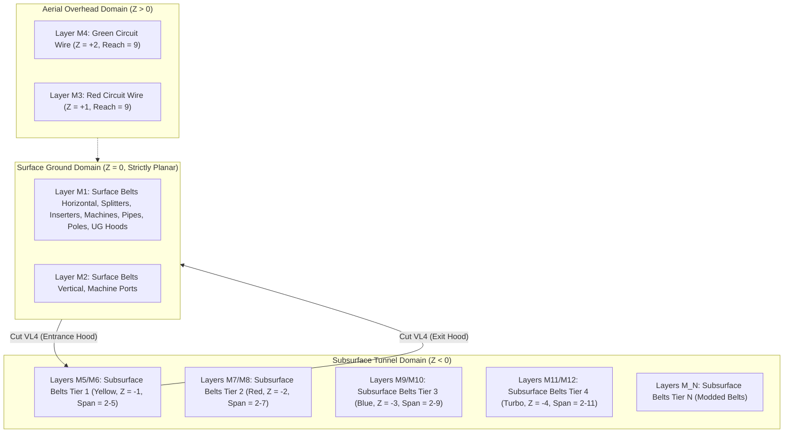
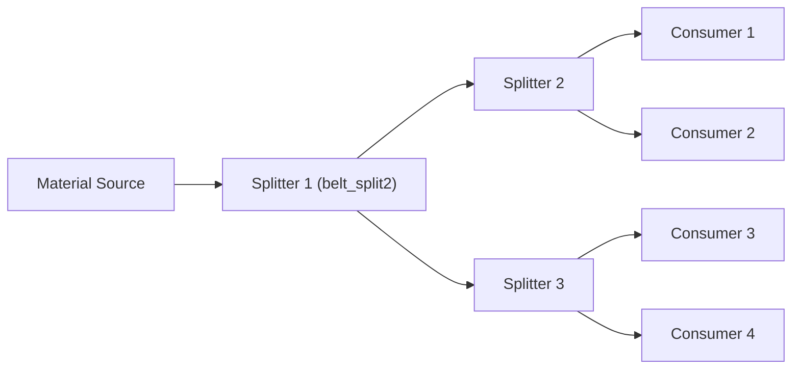
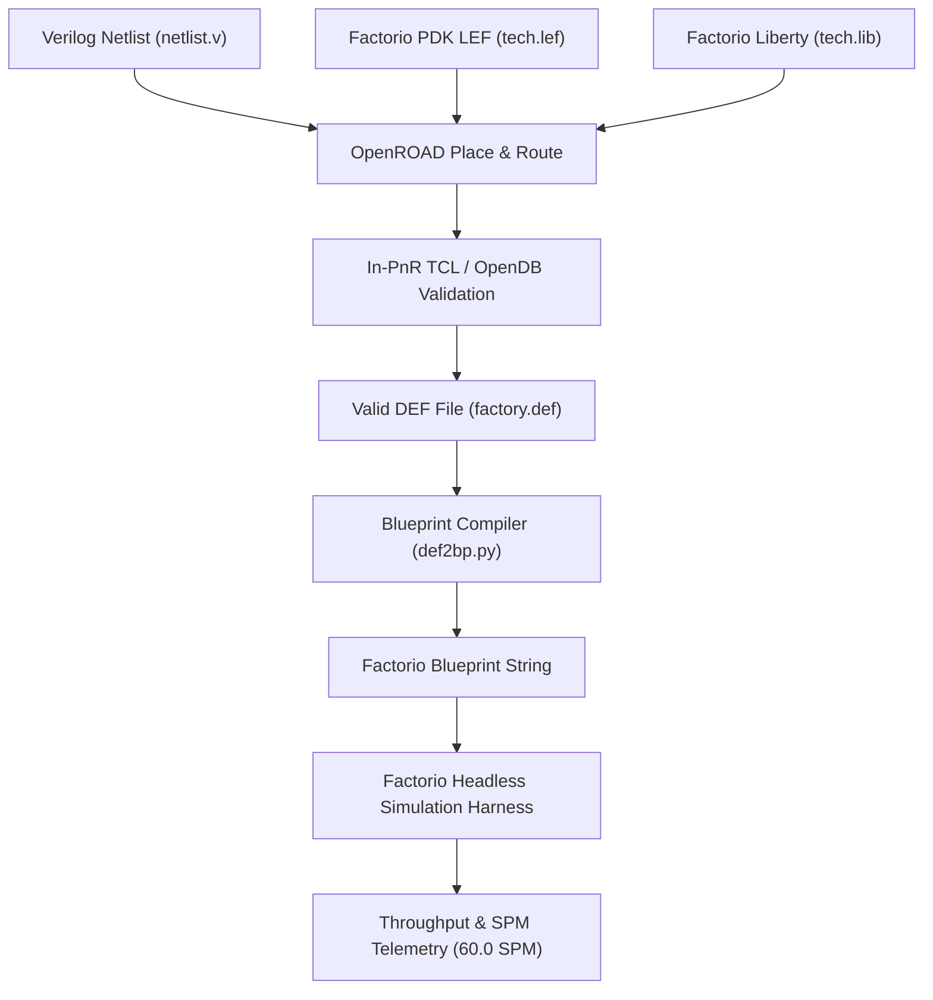
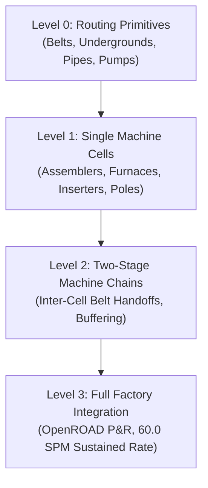

# Factorio PDK Architecture & Physical Design Specification

## 1. Executive Summary & Design Principles

The **Factorio PDK** connects electronic design automation (EDA) tools to vanilla **Factorio 2.0** physical mechanics.

### 1.1 Core Principles
1. **Zero Game Modification**:
   - The factory runs in an unmodded, vanilla Factorio simulation.
   - The design uses no script cheats, no Lua item teleportation, and no infinite power sources.
2. **Physical Legitimacy**:
   - All machine inputs and outputs must pass through physical entities: inserters, belts, underground hoods, splitters, or pipes.
3. **EDA Flow Maximization**:
   - OpenROAD must perform placement, routing, and design rule checking (DRC) according to physical constraints.
   - We must remove fragile post-processing scripts. We must define correct geometry, layer rules, and routing costs before routing.

---

## 2. Factorio PDK Concepts & Library Definitions

### 2.1 Units and Manufacturing Grid
- **1 Factorio Tile = 1.0 Micron ($\mu\text{m}$)**.
- **Database Units (DBU)**: 1000 DBU per Micron (1 nanometer per unit).
- **Manufacturing Grid**: 0.001 $\mu\text{m}$.
- **Site Definition**: `SITE tile` with dimensions $1.0\ \mu\text{m} \times 1.0\ \mu\text{m}$, class `CORE`.

### 2.2 Standard Cell Library

#### A. Machine Standard Cells (Solid Items & Fluids)
Machines cannot interface with belts directly.
- **Solid Items**: Connect through dedicated inserter columns.
- **Fluids**: Connect through fixed fluid ports (`fluid_box` coordinates on the building perimeter). Fluids use direct pipes or pipe-to-ground hoods, never inserters.
- **Hybrid Recipes**: Some machines process both solid items and fluids. For example, Sulfur needs Water and Petroleum Gas to make solid Sulfur. Plastic needs Coal and Petroleum Gas. Processing Units need Circuits and Sulfuric Acid. Hybrid cells include inserter columns and fixed perimeter fluid pins.

| Macro Name | Machine Core | Machine Size | Inserter Cols | Fixed Fluid Ports | Macro Footprint | Solid Pins | Fluid Pins |
|:---|:---|:---|:---|:---|:---|:---|:---|
| `assembling_machine_3__*` | Assembling Machine 3 | 3x3 | In: Col 0, Out: Col 4 | Optional (1 in, 1 out) | **5x3** | $x = 0.0, 5.0$ | Edge fluid ports |
| `electric_furnace__*` | Electric Furnace | 3x3 | In: Col 0, Out: Col 4 | None | **5x3** | $x = 0.0, 5.0$ | None |
| `oil_refinery__*` | Oil Refinery | 5x5 | None (all fluid) | 2 inputs (W), 3 outputs (E) | **5x5** | None | Fixed offsets |
| `chemical_plant__*` | Chemical Plant | 3x3 | In: Col 0, Out: Col 4 | 2 inputs (W), 2 outputs (E) | **5x3** | $x = 0.0, 5.0$ | Fixed offsets |
| `steel_furnace__*` | Steel Furnace | 2x2 | In: Col 0, Out: Col 3 | None | **4x2** | $x = 0.0, 4.0$ | None |

```
Hybrid Standard Cell Layout (5x3 Tiles for 3x3 Chemical Plant / Assembler):
       +-------+-------------------------+-------+
       | Col 0 | Col 1   Col 2   Col 3   | Col 4 |
       | (IN)  | (Machine Core 3x3)      | (OUT) |
+------+-------+-------------------------+-------+------+
| y=2  | Ins In| [Fluid Port 1: In]      |       |      |
+------+-------+                         +-------+------+
| y=1  | Ins In|      Chemical           |Ins Out| Belt | <--- Solid Out Net (M1)
+------+-------+       Plant 3           +-------+------+
| y=0  |       | [Fluid Port 2: In]      |[Fluid]| Pipe | <--- Fluid Out Net (M4)
+------+-------+-------------------------+-------+------+
  ^
Solid In Net (M1)
```

#### B. Transport Standard Cells & Splitter Macros
- `belt_split2`: Splitter macro ($1 \times 2$ tiles). Input `a` on West edge. Outputs `y1` and `y2` on East edge.
- `belt_merge2`: Merge macro ($1 \times 2$ tiles). Inputs `a` and `b` on West edge. Output `y` on East edge.
- `pump`: Fluid pump macro ($1 \times 2$ tiles). Input `a` on South edge. Output `y` on North edge.
- **Advanced Splitter Features**:
  - **Input Priority**: Consumes items from the preferred input first.
  - **Output Priority**: Directs items to the preferred output first.
  - **Item Filter**: Directs one specific item type to the prioritized output. All other item types exit through the alternate output.
- **Compound Balancer Macros ($N \times M$)**:
  - Technology mapping can combine elementary gates into larger multi-input macros.
  - In Factorio design, technology mapping synthesizes compound balancers ($2 \times 2$, $4 \times 4$, $8 \times 8$).
  - These macros use elementary $1 \times 2$ splitters and underground jumpers.
  - Compound balancers guarantee uniform lane distribution across multi-belt buses.

#### C. Power Distribution Cells
- `medium_electric_pole`: Footprint $1 \times 1$ tile. Supply area $7 \times 7$ tiles (radius 3.5). Wire reach 9.0 tiles. Standard for early and mid-game distribution.
- `substation`: Footprint $2 \times 2$ tiles. Supply area $18 \times 18$ tiles (radius 9.0). Wire reach 18.0 tiles. Standard for late-game dense standard cell blocks.
- `big_electric_pole`: Footprint $2 \times 2$ tiles. Supply area $4 \times 4$ tiles (radius 2.0). Wire reach 32.0 tiles. Standard for long-distance inter-block power transmission.

#### D. Control and Telemetry Cells (Circuit Network)
- `display_panel`: Monitor macro ($1 \times 1$ tile). Reads wire signals to show real-time factory status.
- `arithmetic_combinator`: Arithmetic combinator macro ($1 \times 2$ tiles). Performs math operations on signals.
- `decider_combinator`: Decider combinator macro ($1 \times 2$ tiles). Evaluates conditional logic.
- `constant_combinator`: Constant combinator macro ($1 \times 1$ tile). Supplies reference constant signals.

### 2.3 Timing and Throughput Modeling (Liberty `.lib`)
- **Clock**: Factorio simulation tick (60 ticks per second).
- **Crafting Delay**: Recipe crafting time converted to gate delay:
  $$\text{Delay} = \frac{\text{Recipe Energy}}{\text{Machine Crafting Speed}}$$
- **Bandwidth Capacitance**: Belt flow capacity mapped to pin capacitance:
  - Yellow Belt: 15 items/second (7.5 items/second per lane).
  - Red Belt: 30 items/second (15.0 items/second per lane).
  - Blue Belt: 45 items/second (22.5 items/second per lane).
  - Turbo Belt: 60 items/second (30.0 items/second per lane).
- **Inserter Slew Limit**: Fast inserter swing rate (2.31 swings/second with hand size 1) defines the transition slew.

---

## 3. Physical Layer Stackup Architecture

### 3.1 The Surface Plane Invariant ($Z = 0$)
**All physical entities that exist above ground occupy the same ground plane ($Z = 0$)**.
This rule applies to:
- Surface transport belts, splitters, and turns.
- Inserters and machine core footprints.
- Fluid pipes and pumps.
- Electric power poles and substations.
- **Underground belt entrance and exit hoods**.
- **Pipe-to-ground entrance and exit hoods**.

An underground belt hood occupies tile $(x, y)$ completely. No other surface belt, pipe, inserter, or machine can occupy that tile.

Two different material streams cannot cross on the surface plane without collision. To cross, one stream must dive under the surface.

```
       Silicon Stackup                        Factorio Stackup
  +-----------------------+              +-----------------------+
  | M2 (Vertical Metal)   |              | M13+ (Power / Modded) | (Aerial Overhead, Z = +3)
  +-----------------------+              +-----------------------+
  | Oxide Dielectric      |              | M3/M4 (Circuit Wires) | (Aerial Overhead, Z = +1 / +2)
  +-----------------------+              +-----------------------+
  | M1 (Horizontal Metal) |              | M1/M2 (Surface Belts) | (Ground Surface, Z = 0: All Entities & Hoods)
  +-----------------------+              +-----------------------+
                                         | M5..M12 (Underground) | (Subsurface Tunnels, Z < 0)
                                         +-----------------------+
```

### 3.2 The Three Physical Z-Domains of Factorio



#### 1. Aerial Domain ($Z > 0$)
- **Entities**: Red circuit wires (`M3`, $Z=+1$), green circuit wires (`M4`, $Z=+2$), and copper electric wires ($Z=+3$).
- **Rules**: Wires fly overhead. They never collide with surface entities or each other. Maximum span is 9 tiles for circuit wires and medium poles, and up to 32 tiles for big poles.

#### 2. Surface Ground Domain ($Z = 0$)
- **Entities**: Transport belts (`M1`/`M2`), splitters, inserters, machine cores, fluid pipes, electric poles, and underground hoods.
- **Rules**: Strictly planar. Exactly one entity can occupy one ground tile. Two surface entities cannot overlap.

#### 3. Subsurface Domain ($Z < 0$)
- **Entities**: Underground belts and pipe-to-ground tunnels.
- **Dynamic Tier Generation**:
  - The PDK extracts underground belt tiers directly from Factorio prototype tables (`Data.prototypes["underground-belt"]`).
  - Speed determines tier order:
    - Tier 1: Yellow Underground (`underground-belt`, `M5`/`M6`, $Z = -1$, span 2–5).
    - Tier 2: Red Underground (`fast-underground-belt`, `M7`/`M8`, $Z = -2$, span 2–7).
    - Tier 3: Blue Underground (`express-underground-belt`, `M9`/`M10`, $Z = -3$, span 2–9).
    - Tier 4: Turbo Underground (`turbo-underground-belt`, `M11`/`M12`, $Z = -4$, span 2–11).
    - Modded Tiers: Space Age and modded belts map automatically to layers $M_{13} \dots M_N$.
- **Rules**:
  - Underground belts are straight 1D segments. They cannot turn underground.
  - Orthogonal underground runs (East-West and North-South) do not collide.
  - Collinear underground runs of different tiers (weaving) do not collide.
  - Surface tiles between entrance and exit hoods remain completely free for surface belts, pipes, or machines.

### 3.3 Layer Stackup Mapping Table

| Layer Name | Type | Direction | Factorio Physical Entity | Physical Constraints |
|:---|:---|:---|:---|:---|
| **M1** | Routing | Horizontal | **Surface Belts Horizontal** | Ground tile ($Z=0$). 1 entity per tile. Belts, pipes, hoods. |
| **VL1** | Cut (`via`) | Contact | **Surface Turn** | Corner turn between M1 and M2. |
| **M2** | Routing | Vertical | **Surface Belts Vertical** | Ground tile ($Z=0$). Machine ports, vertical belts. |
| **VL2** | Cut (`via`) | Contact | **Circuit Drop** | Connection between surface entity and M3 circuit red wire. |
| **M3** | Routing | Horizontal | **Red Circuit Wire** | Aerial ($Z=+1$). Reach $\le 9$ tiles. Signal bus. |
| **VL3** | Cut (`via`) | Contact | **Circuit Turn** | Connection between M3 and M4 circuit wires. |
| **M4** | Routing | Vertical | **Green Circuit Wire** | Aerial ($Z=+2$). Reach $\le 9$ tiles. Signal bus. |
| **VL4** | Cut (`via`) | Contact | **Underground Belt Hood** | Transition between surface (M2) and underground (M5). |
| **M5** | Routing | Horizontal | **Yellow Underground Tunnel / Pipe** | Subsurface ($Z=-1$). Min span 2 tiles, max span 5 tiles (pipe: 11). |
| **VL5** | Cut (`via`) | Contact | **Underground Turn** | Subsurface layer connection. |
| **M6** | Routing | Vertical | **Yellow Underground Tunnel** | Subsurface ($Z=-1$). Min span 2 tiles, max span 5 tiles. |
| **M7 / M8** | Routing | 1D Orthogonal | **Red Underground Tunnel** | Subsurface ($Z=-2$). Min span 2 tiles, max span 7 tiles. |
| **M9 / M10** | Routing | 1D Orthogonal | **Blue Underground Tunnel** | Subsurface ($Z=-3$). Min span 2 tiles, max span 9 tiles. |
| **M11 / M12** | Routing | 1D Orthogonal | **Turbo Underground Tunnel** | Subsurface ($Z=-4$). Min span 2 tiles, max span 11 tiles. |

### 3.4 Contact Layer (`via`) Rules and Exclusion Constraints
1. **No Layer Changes Between Subsurface Layers**:
   - Belts cannot change layers while underground.
   - An underground run must return to M1 (surface) before changing layer or direction.
2. **Minimum Span Rule**:
   - The minimum underground belt span is **2 tiles total including both hoods**.
   - An entrance hood at coordinate $X$ and an exit hood at coordinate $X+1$ are adjacent and physically valid.
   - An underground belt cannot occupy 1 tile.
3. **Maximum Span Rules**:
   - Yellow belt (M5/M6): Maximum span is 5 empty intermediate tiles (6 tiles hood-to-hood).
   - Red belt (M7/M8): Maximum span is 7 empty intermediate tiles (8 tiles hood-to-hood).
   - Blue belt (M9/M10): Maximum span is 9 empty intermediate tiles (10 tiles hood-to-hood).
   - Turbo belt (M11/M12): Maximum span is 11 empty intermediate tiles (12 tiles hood-to-hood).
   - Underground pipe (M5): Maximum span is 10 empty intermediate tiles (11 tiles hood-to-hood).

---

## 4. Standard Cell Placement & Floorplanning Strategy

### 4.1 Floorplan Density and Routing Channels
- **Core Density**: Set target density between 4% and 6% (`BLOCK_FILL 0.05`).
- **Channel Routing**:
  - In silicon design, low density leaves empty silicon area.
  - In Factorio design, low density creates wide horizontal routing channels between machine rows.
  - Wide channels allow multi-lane belt buses, splitter distribution trees, power poles, and underground underpasses without congestion.

```
+-------------------------------------------------------------------------+
| Machine Row 0: Assemblers (5x3 Cells)                                   |
+-------------------------------------------------------------------------+
| Routing Channel 0: Multi-Lane Main Bus & Splitter Trees (Width: 8-12)   |
+-------------------------------------------------------------------------+
| Machine Row 1: Electric Furnaces (5x3 Cells)                            |
+-------------------------------------------------------------------------+
| Routing Channel 1: Input Material Distribution Channels (Width: 8-12)   |
+-------------------------------------------------------------------------+
```

### 4.2 Inserter Timing and Hand Size Constraints
- A fast inserter has a base rotation speed of 0.04 turns/tick (2.4 turns/second).
- With hand size 1, maximum inserter throughput is 144 items/minute.
- Machine recipes requiring higher throughput use multiple input inserters placed along the input column (Column 0 of the macro).

---

## 5. Dual-Lane Belt Dynamics & Multi-Item Surface Ingestion

### 5.1 Dual-Lane Belt Mechanics
Every transport belt contains two independent lanes: the **Left Lane** and the **Right Lane**.
- **Item Capacity**:
  - A belt tile carries 8 items total. The Left Lane holds 4 items, and the Right Lane holds 4 items.
  - Maximum speed for yellow belt is 15.0 items/second (7.5 items/second per lane).
- **Physical Isolation**:
  - Items on the Left Lane and Right Lane never mix during straight transport or 90° turns.
  - A single physical belt can carry two distinct materials simultaneously. For example, Iron on Left and Copper on Right.

### 5.2 Inserter Interaction with Dual-Lane Belts
1. **Pickup Mechanics**:
   - An inserter can pick up items from **either lane** of a belt.
   - A belt can carry Iron Plates on the near lane and Copper Plates on the far lane. When the machine needs both, a single inserter feeds both ingredients from one tile.
   - If two inserters sit on opposite sides of the same belt tile, both inserters can pick up items from that tile concurrently.
2. **Drop Mechanics**:
   - An inserter always drops items onto the **far lane** of the target belt.
   - Dropping onto the near lane requires sideloading through an intermediate perpendicular belt tile.

### 5.3 Multi-Item Consumption on a Single Surface Tile
Recipes often require multiple ingredients (for example, Automation Science Pack requires 1 Copper Plate + 1 Iron Gear Wheel). The Factorio PDK supports three ingestion architectures:

```
Method A: Dual-Lane Single Belt Feed       Method B: Multi-Belt Inserter Array
(1 Belt Tile, 2 Ingredients)              (2 Belts, 2 Dedicated Inserters)

    +-------------------+                     +-------------------+
    | Machine Core      |                     | Machine Core      |
    +---+---------------+                     +---+-------+-------+
    |Ins| (Picks both)                        |Ins| (Row1)|Ins| (Row2)
    +---+                                     +---+-------+---+---+
    |Belt [Iron | Copper]                     |Belt 1     |Belt 2
    | (1 Tile carries both)                   | (Iron)    | (Copper)
```

1. **Dual-Lane Bundling (Method A)**:
   - Combine two material nets onto one physical belt (Left Lane = Net A, Right Lane = Net B).
   - A single inserter at Column 0 ($y = 1$) ingests both materials.
   - Reduces belt track count by 50% in routing channels.
2. **Multi-Belt Inserter Array (Method B)**:
   - Dedicated belt for each ingredient arriving at Column 0.
   - Inserter at $y = 1$ picks from Belt 1 (Iron). Inserter at $y = 2$ picks from Belt 2 (Copper).
   - Used when material throughput exceeds 7.5 items/second (the capacity of one lane).

### 5.4 Belt Turning and Sideloading Rules
The interaction between perpendicular belts depends strictly on upstream belt continuity:

```
Case 1: Corner Turn (No Upstream Tail)      Case 2: Sideloading (Upstream Tail Exists)

    Belt A ---> [Tile X]                      Belt A ---> [Tile X]
                   |                                         |
                   v (Turns South)                           v (Deposits on Near Lane)
                Belt B                                    [Tail] ---> [Tile X] ---> Belt B
    Tile X becomes a 90° curve.               Tile X remains straight East.
    Full belt throughput (15/s).              Belt A drops onto near lane only (7.5/s).
```

1. **The Corner Turn Rule**:
   - Belt A can feed perpendicular into Belt B. When Belt B has no upstream tail, Belt B curves.
   - Tile X becomes a 90° turn. Both lanes transfer smoothly.
2. **The Sideloading Rule**:
   - Sideloading occurs only when Belt B has an upstream tail feeding into Tile X.
   - Belt A cannot turn. It drops items only onto the near lane of Belt B.
3. **The Dual Perpendicular Entry Rule**:
   - Two perpendicular belts can feed into opposite sides of a tile with no tail. They meet and form a combined dual-lane belt without a turn.

---

## 6. Splitter Dynamics & Fanout Tree Synthesis

### 6.1 Splitter Mechanics
- Splitters occupy $1 \times 2$ tiles (facing East/West) or $2 \times 1$ tiles (facing North/South).
- Splitters contain an internal $2 \times 2$ crossbar. Items from any input lane can reach any output lane.
- **Split Operation (1 Input $\to$ 2 Outputs)**:
  - Divides an incoming stream 50/50 across two output belts.
- **Merge Operation (2 Inputs $\to$ 1 Output)**:
  - Combines two incoming belts onto a single output belt with equal priority.
  - Throughput reaches up to the maximum belt limit (15 items/second for yellow belt).
- **Filtering & Priority Modes**:
  - Input priority resolves upstream contention.
  - Output priority and filtering isolate material streams without dedicated sorting machines.

### 6.2 Fanout and Tree Synthesis (Belts as Signal Trees)
In digital logic, one gate output pin can drive multiple input pins with zero area cost.
In Factorio, **belts cannot branch with wire T-junctions**.
To distribute a material to multiple consumers, the PDK synthesizes a **Splitter Tree**:



- A fanout of $N$ sinks requires a balanced binary tree of $N-1$ `belt_split2` instances.
- Netlist synthesis in [`foundry/netlist.py`](../foundry/netlist.py) automatically generates these trees as structural Verilog modules.

---

## 7. Underground Belt Mechanics & Geometric Constraints

### 7.1 Entrance and Exit Hood Rules
- **Entrance Hood (`type: input`)**:
  - Receives items from the surface belt behind it.
  - **Rear Entry Only**: Items must enter the hood from behind. Side-loading directly into an underground hood is blocked.
- **Exit Hood (`type: output`)**:
  - Spills items forward onto the surface belt directly ahead.

### 7.2 Underground Underpass Weaving
- Different tiers of underground belts run at different subsurface depths:
  - Yellow: $Z = -1$
  - Red: $Z = -2$
  - Blue: $Z = -3$
- **Underground Crossing**:
  - An East-West underground belt and a North-South underground belt never collide.
- **Collinear Weaving**:
  - A yellow underground belt and a red underground belt can run along the same line on the same tiles without connecting.

```
Surface (Z=0):    [Belt] --------> [Surface Belt] --------> [Belt]
Underground Z=-1:         [In Hood] ================= [Out Hood]  (Yellow Tunnel)
Underground Z=-2:   [In Hood] ============================= [Out Hood] (Red Tunnel)
```

---

## 8. Power Distribution Network (PDN) Physical Design

Power production may be external or isolated during testing, but **power distribution routing must be 100% physically legitimate**. Every machine, inserter, and pump requires electric power to operate.

### 8.1 Physical Electric Pole Progression

| Entity | Footprint | Supply Area Box | Supply Radius | Wire Reach | Factory Progression Role |
|:---|:---|:---|:---|:---|:---|
| `medium-electric-pole` | $1 \times 1$ | $7 \times 7$ tiles | 3.5 tiles | 9.0 tiles | **Early/Mid-game**: Placed along standard cell rows. |
| `substation` | $2 \times 2$ | $18 \times 18$ tiles | 9.0 tiles | 18.0 tiles | **Late-game**: Area grid covering dense cell blocks. |
| `big-electric-pole` | $2 \times 2$ | $4 \times 4$ tiles | 2.0 tiles | 32.0 tiles | **Inter-block**: Long-distance transmission lines. |

### 8.2 Power Distribution Constraints
1. **Supply Area Coverage Constraint**:
   - Every powered machine core and inserter entity must intersect the supply area box of at least one electric pole.
   - An entity outside all supply areas receives zero watts and stays idle.
   - Formal check: $\max(|x_{\text{ent}} - x_{\text{pole}}|, |y_{\text{ent}} - y_{\text{pole}}|) \le \text{supply\_radius}$.
2. **Copper Wire Graph Connectivity**:
   - All placed poles must form a connected graph back to the factory power tap point.
   - Distance between two connected poles must satisfy:
     $$\sqrt{(x_1 - x_2)^2 + (y_1 - y_2)^2} \le \text{maximum\_wire\_distance}$$
   - Poles cannot connect across distances greater than their wire reach (9.0 tiles for medium pole, 18.0 tiles for substation).

### 8.3 PDN Implementation in the PnR Flow
- **Early/Mid-Game Topology (Medium Poles)**:
  - Insert `medium-electric-pole` ($1 \times 1$) as tap cells every 7 tiles along machine rows.
  - Automatic copper wire connections chain adjacent poles together.
- **Late-Game Topology (Substation Grid)**:
  - Place `substation` macros ($2 \times 2$) in routing channels on an $18 \times 18$ grid.
  - A single row of substations covers an entire standard cell block.
- **Verification Rule**:
  - The blueprint compiler executes `check_power()`: reports the count of unpowered entities. Zero unpowered entities is a mandatory pass condition.

---

## 9. Circuit Network Automation & Telemetry (Red & Green Wires)

The Circuit Network provides aerial control signals ($Z = +1$ and $Z = +2$) to monitor, balance, and automate material flow.

### 9.1 Network Architecture
- **Dual Isolated Channels**:
  - Red wire (`M3`) and Green wire (`M4`) are independent aerial signal buses.
  - Wires attach directly to machines, inserters, belts, combinators, chests, and power poles without taking ground tile space.
  - Multiple connections on the same wire color form a summing junction (signals with the same name add together).
- **Physical Wire Reach**:
  - Maximum aerial span between two connection points is 9.0 tiles.

### 9.2 PDK Control & Telemetry Cells
1. **Display Panels (`display_panel`)**:
   - Connects to red or green wire to show real-time numerical throughput, buffer levels, or warning icons.
2. **Arithmetic Combinator (`arithmetic_combinator`)**:
   - Performs signal calculations: scaling, division, or item accumulation across simulation ticks (rate integration).
3. **Decider Combinator (`decider_combinator`)**:
   - Evaluates logic conditions ($A > B$, $A = 0$) to emit enable/disable pulses.
4. **Belt & Inserter Taps**:
   - **Belt Sensor**: Belts set to `read_contents` broadcast item counts to the circuit wire.
   - **Gated Belt**: Belts set to `enable_disable` stop item movement until an enable signal is received.
   - **Inserter Control**: Inserters enable or disable based on downstream buffer thresholds, preventing over-production and starvation.

---

## 10. Factorio Static Timing Analysis (STA) & Critical Path Latency

In semiconductor design, Static Timing Analysis (STA) calculates the arrival times of signals to verify clock constraints.
In Factorio design, **Static Timing Analysis calculates the total transit and crafting delay across the factory pipeline**.

### 10.1 Pipeline Latency Components
For every recipe stage $k$, three physical parts define delay $T_k$:
1. **Belt Transit Latency ($T_{\text{belt}}$)**:
   $$T_{\text{belt}} = \frac{\text{Wire Length (tiles)}}{\text{Belt Speed (tiles/tick)}} \quad \text{ticks}$$
   For yellow belt, speed is $0.03125\ \text{tiles/tick}$ ($32\ \text{ticks/tile}$).
2. **Inserter Swing Latency ($T_{\text{inserter}}$)**:
   - Fast inserter swing takes approximately 26 ticks to pick up and drop items.
3. **Machine Crafting Latency ($T_{\text{craft}}$)**:
   $$T_{\text{craft}} = \frac{\text{Recipe Energy}}{\text{Machine Crafting Speed}} \times 60\ \text{ticks}$$

### 10.2 Critical Path Latency Formulation
The **Factory Critical Path Latency ($T_{\text{crit}}$)** is the maximum pipeline delay from raw inputs to science outputs.
$$T_{\text{crit}} = \max_{p \in \text{Paths}} \sum_{k \in p} \left( T_{\text{belt}, k} + T_{\text{inserter}, k} + T_{\text{craft}, k} \right)$$

### 10.3 Dynamic Simulation Duration Rule
A fixed simulation duration (such as 7200 ticks / 120 seconds) is not always sufficient for deep production chains.
If the pipeline warmup time exceeds the test duration, throughput sampling will falsely report starvation.

The verification harness uses OpenSTA and netlist traversal to compute $T_{\text{crit}}$ before starting simulation:
$$T_{\text{sim\_ticks}} \ge T_{\text{crit}} + T_{\text{sample}} = T_{\text{crit}} + 3600\ \text{ticks}$$
This ensures the factory reaches steady state before measuring the sustained 60.0 SPM rate.

---

## 11. Verification and In-PnR Automation Architecture



### 11.1 In-PnR TCL Automation (OpenROAD Stage)
1. **Cut Layer (`via`) Weighting**:
   - In [`flow/3_route.tcl`](../flow/3_route.tcl), assign high weights to underground cut layers (`VL12`, `VL13`).
   - OpenROAD prioritizes planar surface belts (M1) and only dives underground when crossing an obstacle or orthogonal net.
2. **OpenDB (`odb`) Physical Validation**:
   - A TCL script queries the `odb` block database directly after routing.
   - The script verifies wire spans, endpoints, and cut layers.
   - Detect any unplanned overlaps before writing DEF.

### 11.2 In-Simulation Lua Verification (Factorio Engine Stage)
1. **Entity Placement Validation**:
   - Execute `surface.can_place_entity()` for every entity in the blueprint to confirm zero collisions.
2. **Underground Partner Pairing**:
   - Inspect `entity.neighbour` on all underground hoods to verify 100% paired connectivity.
3. **Power Network Verification**:
   - Execute `check_power()` to verify that 100% of machines and inserters have active electrical connections.
4. **Dynamic Throughput Telemetry**:
   - Run headless Factorio simulation for $T_{\text{sim\_ticks}} \ge T_{\text{crit}} + 3600$ ticks.
   - Sample item production rates every 60 ticks.
   - Confirm sustained production of `automation-science-pack` at 60.0 SPM with zero starvation.

---

## 12. Objective-Driven Test Suite Hierarchy

The test architecture uses four progressive levels. Each level validates specific Factorio objectives before full factory integration.



### 12.1 Level 0: Physical Routing Primitives
The file `test/test_routing_primitives.py` tests transport elements in small Factorio worlds:
- **Belt Kinematics**:
  - Belts are one-way and turn at 90-degree angles.
  - Direct belt turns preserve distinct item lanes.
  - Perpendicular belt intersections sideload items onto a single lane.
- **Underground Belts**:
  - An underground pair requires an input hood and an output hood on the surface plane.
  - Belts cross underground spans without colliding with surface entities.
- **Fluid Mechanics**:
  - Pipe-to-ground pairs span underground distances between two surface endpoints.
  - Powered pumps enforce unidirectional flow and prevent reverse fluid movement.

### 12.2 Level 1: Single Machine Cells
The file `test/test_machine_cells.py` tests individual PDK standard cells through OpenROAD and headless Factorio.

#### 100% Core Machine Library Coverage
The PDK extracts ten core machines from Factorio. The test suite enforces 100 percent bidirectional test coverage of this machine cell library. If any core machine lacks an end-to-end test, the test suite raises an error.

The ten core machines are:
1. `assembling-machine-1`: 3x3 electric crafting cell (recipe: `iron-gear-wheel`).
2. `assembling-machine-2`: 3x3 electric crafting cell (recipe: `electronic-circuit`).
3. `assembling-machine-3`: 3x3 electric crafting cell (recipe: `automation-science-pack`).
4. `stone-furnace`: 2x2 burner smelting cell (recipe: `copper-plate`).
5. `steel-furnace`: 2x2 burner smelting cell (recipe: `iron-plate`).
6. `electric-furnace`: 3x3 electric smelting cell (recipe: `iron-plate`).
7. `chemical-plant`: 3x3 electric chemical cell with solid and fluid pins (recipe: `plastic-bar`).
8. `oil-refinery`: 5x5 electric oil processing cell with fluid pins (recipe: `basic-oil-processing`).
9. `centrifuge`: 3x3 electric centrifuging cell (recipe: `uranium-processing`).
10. `rocket-silo`: 9x9 electric rocket assembly cell (recipe: `rocket-part`).

The test suite also verifies circuit network macros:
- `arithmetic-combinator`: 1x2 circuit network cell for telemetry signal accumulation.

#### End-to-End Pipeline for Machine Cells
Each cell test executes the full EDA flow:
1. Generate Verilog netlist, LEF, and Liberty files for the single cell.
2. Execute OpenROAD to place the cell and edge pins.
3. Run detailed routing on surface and underground layers.
4. Verify that TritonRoute reports zero design rule violations.
5. Compile the routed DEF file into a blueprint using `def2bp.py`.
6. Load the blueprint into headless Factorio for physical simulation.

#### Verification Criteria for Machine Cells
Every cell test must satisfy six criteria:
1. **Zero DRC Violations**: OpenROAD detailed routing completes with zero violations.
2. **Zero Collision Placement**: Headless Factorio builds 100 percent of blueprint entities without collision errors.
3. **Physical Electric Supply**: An `electric-energy-interface` supplies power to a `medium-electric-pole`. The pole powers the machine and inserters. The test uses no artificial Lua energy injection.
4. **Correct Inserter Offsets**: Inserters pick up items from belt coordinates and drop items into machine bounding boxes.
5. **Autonomous Crafting**: The machine crafts items when supplied with ingredients and electricity.
6. **Item Conservation**: The total count of consumed ingredients and produced outputs strictly matches the recipe definition.

### 12.3 Level 2: Two-Stage Machine Chains
The file `test/test_machine_chains.py` tests connected cells through OpenROAD and Factorio.

#### End-to-End Pipeline for Machine Chains
The two-stage chain tests execute the full automation pipeline.

1. Synthesize a two-machine netlist from recipe definitions.
2. Execute OpenROAD to place both cells and route the connecting material net.
3. Validate routing with zero DRC violations.
4. Compile the routed DEF into a Factorio blueprint.
5. Simulate the blueprint in headless Factorio to verify inter-cell material flow.

#### Verification Criteria for Machine Chains
Every two-stage chain test must satisfy these criteria.

- **Cell Handoff**:
  - OpenROAD routes the output of Cell A (`iron-gear-wheel`) into the input of Cell B (`automation-science-pack`).
  - Verifies that output inserter drop lines align with downstream input inserter pickup lines.
- **Backpressure and Buffer Stability**:
  - Verifies that belt congestion does not deadlock machines or stall upstream production.

### 12.4 Level 3: Full Factory Integration
The files `flow/benchmark_factory.py` and `test/test_e2e.py` validate the full automated flow:
- Netlist synthesis from recipe specifications.
- Macro placement and detailed routing with OpenROAD.
- Minimum Spanning Tree electric power network synthesis.
- Sustained production of 60.0 science packs per minute in headless Factorio.

