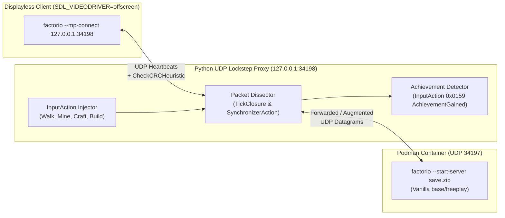

# Factorio Multiplayer Protocol and Lockstep Proxy Architecture

## 1. Overview

Factorio multiplayer operates over UDP (default port `34197` for game traffic and `34196` for LAN broadcast). The engine uses a deterministic lockstep model. The server does not stream entity coordinates, inventory contents, or world deltas to connected clients. Instead, a joining client downloads a snapshot of the map archive (`TransferBlock`). The client then exchanges per-tick `TickClosure` messages that contain deterministic `InputAction` commands.

This document specifies the binary wire format of the Factorio Game Protocol (`2.1.23`). It also explains headless and offscreen execution and defines the UDP Lockstep Proxy architecture for [`factorilog`](../README.md).

---

## 2. Primitive Wire Encodings

All multi-byte integer fields use little-endian byte order unless noted otherwise.

| Type | Encoding Rule |
| :--- | :--- |
| `uint8` / `int8` | 1 byte. |
| `uint16` / `int16` | 2 bytes, little-endian. |
| `uint32` / `int32` | 4 bytes, little-endian. |
| `uint64` / `int64` | 8 bytes, little-endian. |
| `uint16v` | Space-optimized `uint16`. Read 1 byte (`b0`). If `b0 < 0xff`, value is `b0`. If `b0 == 0xff`, read the next 2 bytes as `uint16`. |
| `uint32v` | Space-optimized `uint32`. Read 1 byte (`b0`). If `b0 < 0xff`, value is `b0`. If `b0 == 0xff`, read the next 4 bytes as `uint32`. |
| `String` | `length: uint32v` followed by `length` UTF-8 bytes. |
| `MapPosition` | `x: int32`, `y: int32` in fixed-point $1/256$ tile units ($1\text{ tile} = 256$). |
| `ModID` | `name: String`, `major: uint16v`, `minor: uint16v`, `sub: uint16v`, `crc: uint32`. |

---

## 3. Packet Framing (`NetworkMessageHeader`)

Every UDP datagram starts with a 1-byte `flags` field:

```
  Bit 7          Bit 6        Bit 5     Bits 4..0
+--------------+------------+--------+-------------------+
| lastFragment | fragmented | random | message_type (5b) |
+--------------+------------+--------+-------------------+
```

- **Bits `0..4` (`flags & 0x1f`)**: `NetworkMessageType` (values `0` through `18`).
- **Bit `5` (`0x20`)**: `random` (checksum perturbation bit).
- **Bit `6` (`0x40`)**: `fragmented` (set when the message is split across multiple UDP packets or carries reliable delivery confirmations).
- **Bit `7` (`0x80`)**: `lastFragment` (marks the final fragment of a fragmented message).

### 3.1 Reliable Delivery and Fragment Header

A reliable header immediately follows `flags` when `fragmented == 1`, or unconditionally when `message_type` is `ConnectionRequest` (`2`) or `ConnectionRequestReplyConfirm` (`4`):

1. `msg_id_and_confirm: uint16`:
   - Bits `0..14` (`& 0x7fff`): `message_id` (identifies the reliable message).
   - Bit `15` (`& 0x8000`): `confirm` flag (indicates that confirmation records follow).
2. If `fragmented == 1`:
   - `fragment_number: uint8` (0-indexed sequence number of the fragment).
   - When `fragment_number == 0` and `lastFragment == 1`, the payload is a complete unsplit message that uses the fragmented header solely to carry `confirm` acknowledgments.
3. If `confirm == 1`:
   - `confirm_count: uint8`.
   - `confirm_count` $\times$ 4-byte confirmation items acknowledging received reliable messages.

---

## 4. Network Message Types

| Type ID | Name | Direction | Summary |
| :--- | :--- | :--- | :--- |
| `0` | `Ping` | S $\leftrightarrow$ C | `number: uint16` latency probe. |
| `1` | `PingReply` | S $\leftrightarrow$ C | `number: uint16` latency reply. |
| `2` | `ConnectionRequest` | C $\to$ S | `major: uint8`, `minor: uint8`, `patch: uint8`, `build: uint32`, `client_id: uint32`. |
| `3` | `ConnectionRequestReply` | S $\to$ C | `major: uint8`, `minor: uint8`, `patch: uint8`, `build: uint32`, `client_id: uint32`, `server_id: uint32`, `max_packet_size: uint16`. |
| `4` | `ConnectionRequestReplyConfirm` | C $\to$ S | `client_id: uint32`, `server_id: uint32`, `instance_id: uint32`, `username: String`, `password_hash: String`, `server_key: String`, `server_key_timestamp: String`, `core_checksum: uint32`, `prototype_list_checksum: uint32`, `active_mods: ModID[]`, startup settings. |
| `5` | `ConnectionAcceptOrDeny` | S $\to$ C | `client_id: uint32`, `status: uint8` (`0 = Valid`), `game_name: String`, `server_hash: String`, `description: String`, `latency: uint8`, `max_updates_per_second: uint32v`, `game_id: uint32`, `steam_id: uint64`, `clients_peer_info`, `first_seq_to_expect: uint32`, `first_seq_to_send: uint32`, `new_peer_id: uint16`, `active_mods: ModID[]`. |
| `6` | `ClientToServerHeartbeat` | C $\to$ S | Client lockstep heartbeat containing `TickClosure` records, `nextToReceiveServerTickClosure`, and `SynchronizerAction` records. |
| `7` | `ServerToClientHeartbeat` | S $\to$ C | Server lockstep heartbeat broadcasting `TickClosure` records and `SynchronizerAction` records. |
| `8` / `9` | `GetOwnAddress` / `Reply` | C $\leftrightarrow$ S | Reflexive NAT address discovery. |
| `10` / `11` | `NatPunchRequest` / `NatPunch` | C $\leftrightarrow$ S | UDP hole punching. |
| `12` | `TransferBlockRequest` | C $\to$ S | `block_number: uint32` requesting a chunk of the map archive. |
| `13` | `TransferBlock` | S $\to$ C | `block_number: uint32` followed by raw map archive bytes. |
| `14` | `RequestForHeartbeatWhenDisconnecting` | C $\leftrightarrow$ S | `next_seq_id: uint32`, `requests: uint32[]`. |
| `15` | `LANBroadcast` | S $\to$ C | `game_port: uint16` on UDP port `34196`. |
| `16` / `17` | `GameInformationRequest` / `Reply` | C $\leftrightarrow$ S | Server browser query and metadata reply. |
| `18` | `Empty` | C $\leftrightarrow$ S | Empty padding/keepalive packet. |

---

## 5. Handshake, Map Transfer, and Lockstep State Machine

A joining client transitions through the following `ClientMultiplayerStateType` states (reported to the server through `SynchronizerAction::ClientChangedState` (`0x03`)):

| State ID | Name | Description |
| :--- | :--- | :--- |
| `0` | `Ready` | Initial idle state before connection. |
| `1` | `Connecting` | Performing the 4-way `ConnectionRequest` $\to$ `ConnectionAcceptOrDeny` handshake. |
| `2` | `ConnectedWaitingForMap` | Waiting for the server to save the map and emit `MapReadyForDownload` (`0x05`). |
| `3` | `ConnectedDownloadingMap` | Requesting map blocks through `TransferBlockRequest` (`12`) and receiving `TransferBlock` (`13`). |
| `4` | `ConnectedLoadingMap` | Parsing the downloaded `.zip` save archive locally. |
| `5` | `TryingToCatchUp` | Fast-forwarding through `TickClosure` records accumulated while downloading and loading the map. |
| `6` | `WaitingForCommandToStartSendingTickClosures` | Caught up and waiting for the server to emit `ClientShouldStartSendingTickClosures` (`0x04`). |
| `7` | `InGame` | Actively participating in lockstep simulation and sending `TickClosure` records every tick. |

---

## 6. Heartbeats, `TickClosure`, and `InputAction` Wire Format

### 6.1 Heartbeat Structure (`Type 6` and `Type 7`)

```
+-------------------------------------------------------------------+
| heartbeat_flags: uint8                                            |
|   0x01 = HAS_HEARTBEAT_REQUESTS                                   |
|   0x02 = HAS_TICK_CLOSURES                                        |
|   0x04 = HAS_SINGLE_TICK_CLOSURE                                  |
|   0x08 = ALL_TICK_CLOSURES_ARE_EMPTY                              |
|   0x10 = HAS_SYNCHRONIZER_ACTION                                  |
+-------------------------------------------------------------------+
| sequence_number: uint32                                           |
+-------------------------------------------------------------------+
| [If HAS_TICK_CLOSURES (0x02)]:                                    |
|   [If not HAS_SINGLE_TICK_CLOSURE (0x04)]: closure_count: uint8   |
|   TickClosure[0 .. closure_count - 1]                             |
+-------------------------------------------------------------------+
| [If ClientToServerHeartbeat (Type 6)]:                            |
|   next_to_receive_server_tick_closure: uint64                     |
+-------------------------------------------------------------------+
| [If HAS_SYNCHRONIZER_ACTION (0x10)]:                              |
|   sync_count: uint32v                                             |
|   SynchronizerAction[0 .. sync_count - 1]                         |
|     (Server heartbeats append sender_peer_id: uint16 per action)  |
+-------------------------------------------------------------------+
| [If HAS_HEARTBEAT_REQUESTS (0x01)]:                               |
|   req_count: uint8, seq_ids: uint32[req_count]                    |
+-------------------------------------------------------------------+
```

### 6.2 `TickClosure` and `InputAction` Encoding

Each `TickClosure` represents all deterministic inputs scheduled for a specific simulation tick (`update_tick`):

1. `update_tick: uint64`.
2. If `ALL_TICK_CLOSURES_ARE_EMPTY` (`0x08`) is **clear**:
   - `count_and_segments: uint32v`:
     - `action_count = count_and_segments >> 1`
     - `has_segments = (count_and_segments & 1) != 0`
   - Initialize `last_player_index = 0xffff`.
   - Repeat `action_count` times:
     1. `action_type: uint16v` (identifies the `InputAction` variant).
     2. `player_index_delta: uint16v`:
        - Compute `player_index = (last_player_index + player_index_delta) & 0xffff`.
        - Update `last_player_index = player_index`.
        - For the first player (`player_index = 0` on the C++ wire, which corresponds to `1` in Lua) on the first action, `player_index_delta` is `1` because `(0xffff + 1) & 0xffff == 0`. Subsequent actions for the same player use `player_index_delta == 0`.
     3. `action_payload`: bytes specific to `action_type`.
   - If `has_segments` is true:
     - `segment_count: uint8`, followed by segmented large actions (such as large blueprint imports).

### 6.3 Key `InputAction` Payloads

Action enum indices shift between Factorio builds when new actions enter the table. Tools must resolve action indices dynamically from the binary or dissector table (in Factorio `2.1.23`, `AchievementGained` is `0x0159`).

| Action ID (`2.1.23`) | Action Name | Payload Layout | Purpose |
| :--- | :--- | :--- | :--- |
| `0x0001` | `StopWalking` | *(0 bytes)* | Stops character movement. |
| `0x0002` | `BeginMining` | *(0 bytes)* | Starts mining the currently selected entity or resource. |
| `0x0003` | `StopMining` | *(0 bytes)* | Stops mining. |
| `0x000b` | `ClearCursor` | *(0 bytes)* | Returns the item in the player cursor to the inventory. |
| `0x0045` | `Build` | `x: int32`, `y: int32`, `direction: uint8`, `created_by_moving: uint8`, `build_mode: uint8`, `flags: uint8` (12 bytes when `created_by_moving == 0` and `flags < 0x80`) | Places the item currently held in the cursor at fixed-point coordinates `(x, y)`. |
| `0x0046` | `StartWalking` | `direction_x: float64`, `direction_y: float64` (16 bytes) | Moves the character along the specified 2D vector. |
| `0x0047` | `BeginMiningTerrain` | `x: int32`, `y: int32` (8 bytes) | Mines resource tiles at fixed-point coordinates `(x, y)`. |
| `0x0056` | `Craft` | `recipe_id: uint16`, `count: uint32` (6 bytes) | Queues hand-crafting of `recipe_id`. |
| `0x0059` | `SetupAssemblingMachine` | `recipe_id: uint16`, `quality_id: uint8` (3 bytes) | Configures the recipe on the currently opened assembling machine. |
| `0x005a` | `SelectedEntityChanged` | `x: int32`, `y: int32` (8 bytes) | Updates the player entity selection at fixed-point coordinates `(x, y)`. |
| `0x005b` | `Pipette` | `signal_type: uint8 (0=Item)`, `item_id: uint16`, `tile_id: uint16`, `equip_id: uint16`, `quality_id: uint8`, `allow_ghost: uint8`, `exact_quality: uint8` (10 bytes) | Moves `item_id` from the player inventory into the player cursor (`hand`). |
| `0x010d` | `SelectedEntityChangedBasedOnUnitNumber` | `unit_number: uint64` (8 bytes) | Selects the entity with the specified `unit_number`. |
| `0x0159` | `AchievementGained` | `achievement_id: uint16` (2 bytes) | Emitted by the client when local achievement evaluation succeeds and recorded by `InputActionHandler::achievementGained`. |
| `0x015d` | `CheckCRCHeuristic` | `crc: uint32`, `tick_of_crc: uint64` (12 bytes) | Deterministic lockstep state verification. |
| `0x012b` | `WriteToConsole` | `message: String` | Sends chat or console text. |

### 6.4 Dynamic Prototype ID Extraction from `level.dat0` (`savedIDMapping`)

Every `InputAction` that references an achievement, item, recipe, entity, or technology uses a 16-bit runtime prototype ID (`ID<T, uint16>`). Factorio assigns these IDs in `PrototypeList<T>::assignPrototypeIDs` and writes the `savedIDMapping` tables into `level.dat0` inside the `.zip` save archive.

Each `savedIDMapping` table in the zlib-decompressed `level.dat0` stream has the following binary structure:

1. `num_types: uint16` (`<H`).
2. Repeated `num_types` times:
   - `type_name: String` (`length: uint32v`, followed by `length` ASCII bytes, such as `"build-entity-achievement"`, `"item"`, `"recipe"`, or `"assembling-machine"`).
   - `num_prototypes: uint16` (`<H`).
   - Repeated `num_prototypes` times:
     - `prototype_name: String` (`length: uint32v`, followed by `length` UTF-8 bytes, such as `"automate-this"` or `"assembling-machine-1"`).
     - `prototype_id: uint16` (`<H`).

The function [`extract_save_id_mappings`](../foundry/mp_proxy.py) parses these tables from a Factorio save `.zip` archive. This lets [`factorilog`](../README.md) resolve all wire IDs dynamically at runtime without hardcoded constants.

### 6.5 Native Achievement Unlock Conditions (`AchievementStats::allowed` and `Achievement::onGainedLocal`)

Decompilation of `AchievementStats::allowed` (`0x18cab00`) and `Achievement::onGainedLocal` (`0x18cad00`) establishes four runtime requirements for the client binary to emit `AchievementGained` (`0x0159`) onto the UDP wire:

1. **Vanilla Base Mod Only**: Enable only the `base` mod in `mod-list.json` (disable `elevated-rails`, `quality`, `recycler`, and `space-age`).
2. **Scenario Identity and Zero Commands**: The save must originate from `base/freeplay` with `commandsUsed == 0` (`map + 0x246`) and `editorUsed == 0` (`map + 0x247`).
3. **Multiplayer Online Time Fraction**: In multiplayer, `AchievementStats::allowed` requires `player->onlineTime > map->ticksPlayed / 2`. Setting `"auto_pause": true` in `server-settings.json` holds `map->ticksPlayed` at `0` until the client connects, which guarantees `player->onlineTime > map->ticksPlayed / 2`.
4. **Clean Local Achievement State**: In `Achievement::onGainedLocal`, the client suppresses `Player::sendToListeners(InputAction 0x0159)` when `global->localAchievementStats` already marks the achievement as unlocked. An isolated `HOME` directory prevents `steamclient.so` from loading host Steam stats and guarantees a clean local achievement table.

---

## 7. Headless Server + Displayless Offscreen Client + UDP Proxy Architecture

### 7.1 Why Displayless `SDL_VIDEODRIVER=offscreen` Elides `Xvfb`

1. **Podman Server (`--start-server`)**:
   - Runs in true headless mode (`GlobalContext::headlessMode = true`). Requires zero graphics libraries or display servers.
2. **Connected Client (`--mp-connect`)**:
   - Factorio's CLI parser only enables `GlobalContext::headlessMode` for `--start-server`, `--benchmark`, `--run-replay`, and `--dump-data`. Passing `--mp-connect` initializes the client simulation loop, which creates an SDL3 window and OpenGL context.
   - However, Factorio statically links **SDL3**, which includes the `offscreen` video driver (`SDL_VIDEODRIVER=offscreen`).
   - Launching the client with:
     ```bash
     env SteamAppId=427520 SteamGameId=427520 DISPLAY= WAYLAND_DISPLAY= SDL_VIDEODRIVER=offscreen \
       factorio --disable-audio --force-graphics-preset very-low --video-memory-usage low \
       --low-vram --cache-sprite-atlas true --mp-connect 127.0.0.1:<proxy_port>
     ```
     initializes an offscreen EGL surface directly on the GPU/Mesa driver with `DISPLAY=""` and `WAYLAND_DISPLAY=""`.
   - **This configuration needs no X11 server, Wayland compositor, or `Xvfb` process.** With `--cache-sprite-atlas true`, the client boots and connects in ~3.5 seconds.

### 7.2 UDP Lockstep Proxy (`Client <-> Proxy <-> Podman Server`)



This three-part topology provides three advantages.

1. **Zero Desyncs**: The displayless `SDL_VIDEODRIVER=offscreen` client downloads the map, runs the C++ simulation, and computes valid `CheckCRCHeuristic` CRCs every tick.
2. **100% Achievement Eligibility**: A local player connects with the `base` mod only and zero `/c` or `/editor` commands. Thus, `AchievementStats::allowed` returns `true` for all 59 vanilla base-game achievements.
3. **Wire-Level Observation and Injection**: The Python UDP proxy inspects all heartbeats in real time. It detects `AchievementGained` (`0x0159`) packets and injects `InputAction` commands into the outgoing `TickClosure` stream.
