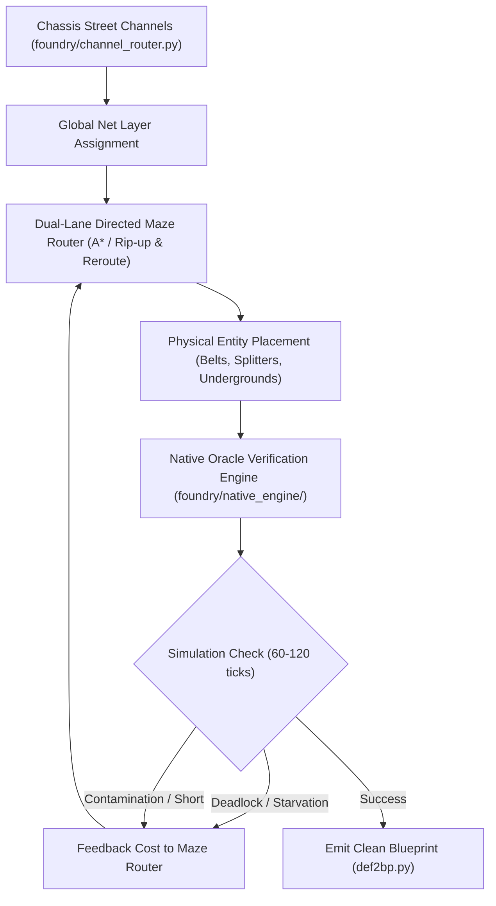

# Native Simulation Oracle & Router Architecture Specification

## 1. Executive Summary & Core Concept

This document specifies the **Native Simulation Oracle & Router Architecture** for [`factorilog`](file:///home/atv/src/factorilog).

### 1.1 The Routing Problem in Factorilog
The current routing flow in [`3_route.tcl`](file:///home/atv/src/factorilog/flow/3_route.tcl) uses OpenROAD TritonRoute. TritonRoute routes electrical metal tracks for integrated circuits. 

Electrical wires and Factorio logistics have incompatible physics:
1. **Directionality**: Electrical tracks conduct current in all directions. Factorio belts and pipes flow strictly in one direction.
2. **Discrete Dual Lanes**: A single transport belt tile contains two physical lanes ($Lane_0$ and $Lane_1$). Each lane holds discrete items with a spacing constraint of $0.25$ tiles ($64$ fixed-point units).
3. **Side-Loading and Merging**: A T-junction connects electrical nets cleanly. In Factorio, a T-junction feeds only one lane. It blocks the other lane and creates backpressure.
4. **Commodity Contamination**: Electrical nets carry voltage signals. Belts carry heterogeneous items. An illegal physical merge permanently contaminates downstream production machines.
5. **Fluid Segments**: Factorio 2.0 pipes form continuous fluid segments with uniform pressure, not resistive networks.

The current workaround in [`jumper.py`](file:///home/atv/src/factorilog/foundry/jumper.py) attempts to post-process electrical wires into belts by inserting underground jumpers. This process creates crossed lines, backwards belts, and throughput deadlocks. The manual checks in [`belt_drc.py`](file:///home/atv/src/factorilog/foundry/belt_drc.py) cannot verify whether items actually flow through the network.

### 1.2 The Native Oracle Solution
Instead of approximating Factorio simulation with manual heuristics, this architecture uses the user-supplied [`factorio`](file:///home/atv/.steam/steam/steamapps/common/Factorio/bin/x64_/factorio) executable directly as a **Native Physical Oracle**:

```
+--------------------------+     +--------------------------+
|  Dual-Lane Maze Router   | --> | Physical Blueprint Graph |
+--------------------------+     +--------------------------+
                                               |
                                               v
                                 +--------------------------+
                                 |  Native Factorio Oracle  |
                                 |  - dlopen(factorio)      |
                                 |  - Step TransportLine    |
                                 |  - Step FluidBuffer      |
                                 +--------------------------+
                                               |
                     +-------------------------+-------------------------+
                     v                                                   v
          [All Items Delivered?]                                [Contamination?]
          YES: Blueprint Approved                                YES: LVS Violation Flagged
```

---

## 2. Native Dynamic Library Integration

### 2.1 ELF PIE Transformation
The Factorio Linux binary is an unstripped Position Independent Executable (`ET_DYN`). Standard `dlopen` rejects PIE binaries because of the `PT_INTERP` header and the `DF_1_PIE` dynamic tag in `DT_FLAGS_1`.

The loader in [`factorio_engine.py`](file:///tmp/f/factorio_engine.py) prepares the binary:
1. Copies the binary to a cache directory ([`factorio_lib.so`](file:///tmp/f/factorio_lib.so)).
2. Changes the `PT_INTERP` program header type from `0x03` to `0x00` (`PT_NULL`).
3. Clears the `DF_1_PIE` bit (`0x08000000`) in `DT_FLAGS_1`.
4. Loads `libsteam_api.so` into global scope.
5. Invokes `dlopen("factorio_lib.so", RTLD_LAZY | RTLD_GLOBAL)`.
6. Resolves runtime base address from `/proc/self/maps`.

### 2.2 Repeatable Symbol Discovery Across Releases
When game updates occur, memory addresses change. The system discovers offsets automatically:

| Routine | Demangled Pattern | Target Mechanism |
| :--- | :--- | :--- |
| [`TransportLine::update`](file:///tmp/f/decompiled/belt_TransportLine_update.cpp) | `^TransportLine::update\(MapTick, unsigned int\)$` | Belt tick processing & propagation |
| [`TransportLine::move`](file:///tmp/f/decompiled/belt_TransportLine_move.cpp) | `^TransportLine::move\(` | Item spacing ($0.25$ tiles) & transfers |
| [`TransportLine::unsquash`](file:///tmp/f/decompiled/belt_TransportLine_unsquash.cpp) | `^TransportLine::unsquash\(` | Deque item spacing restoration |
| [`SplitterLogic::resolveSplitting`](file:///tmp/f/decompiled/belt_SplitterLogic_resolveSplitting.cpp) | `^SplitterLogic::resolveSplitting\(` | 2x2 lane balancing & priority filtering |
| [`FluidBuffer::getFlowRate`](file:///tmp/f/decompiled/pipe_FluidBuffer_getFlowRate.cpp) | `^FluidBuffer::getFlowRate\(` | 24-bit fixed point flow rate calculation |
| [`FluidSegmentManager::buildNewSegment`](file:///tmp/f/decompiled/pipe_FluidSegmentManager_buildNewSegment.cpp) | `^FluidSegmentManager::buildNewSegment\(` | Factorio 2.0 pipe segment grouping |

Fallback discovery uses instruction signatures:
- Spacing constant `0x40` (64 fixed point units = 0.25 tiles).
- Fluid flow multiplier `0.80` and threshold `0x199999` (0.1 units).
- Fixed-point float conversion factor `5.9604644775390625e-08` ($2^{-24}$).

---

## 3. Physical Model: Directed Dual-Lane Grid

### 3.1 The 2-Lane Belt Node
Each belt tile at position $(x, y)$ has two independent directed nodes:
- $Node_{Left}(x, y, d)$
- $Node_{Right}(x, y, d)$

Each lane maintains:
- Item deque: Positions represented as `FixedPointNumberTemplate<int, 8, false>` (256 units per tile).
- Spacing: Minimum $64$ units between adjacent items.
- Capacity: Maximum 4 items per tile per lane (8 items per tile total).

```
                      +---------------+
                      |   Lane Left   | ----> [Flow Direction]
  Belt Tile (x, y)    +---------------+
                      |   Lane Right  | ----> [Flow Direction]
                      +---------------+
```

### 3.2 Canonical Routing Transitions
The router connects lanes according to native transition matrices:

1. **Straight Connection**:
   $$\begin{pmatrix} Lane_{L}(x, y) \\ Lane_{R}(x, y) \end{pmatrix} \longrightarrow \begin{pmatrix} Lane_{L}(x', y') \\ Lane_{R}(x', y') \end{pmatrix}$$

2. **$90^\circ$ Orthogonal Turn**:
   Lanes change arc lengths:
   - Inner lane arc length: $0.785$ tiles.
   - Outer lane arc length: $1.215$ tiles.
   - Both lanes stay separate. Items do not swap lanes during turns.

3. **Side-Load Connection**:
   A belt that enters from the side connects to **one recipient lane**:
   - Left side-load $\longrightarrow$ recipient $Lane_{Left}$.
   - Right side-load $\longrightarrow$ recipient $Lane_{Right}$.
   - The second lane stalls when items block the target lane.

4. **Splitter 2x2 Interleave**:
   Routes items from two lines ($4$ lanes) to two output lines. It uses [`SplitterLogic::resolveSplitting`](file:///tmp/f/decompiled/belt_SplitterLogic_resolveSplitting.cpp).

5. **Underground Belt Pair**:
   Bypasses surface obstacles:
   - Maximum span: $5$ tiles (yellow), $7$ (red), $9$ (blue), $11$ (turbo).
   - Collision rule: Parallel undergrounds of the same tier cannot overlap. Orthogonal undergrounds can cross.

---

## 4. Router Architecture & Verification Pipeline



### 4.1 Phase 1: Global Channel Assignment
Uses the street corridors specified in [`chassis_layout_architecture.md`](file:///home/atv/src/factorilog/docs/chassis_layout_architecture.md). Assigns nets to street lanes to minimize crossings.

### 4.2 Phase 2: Dual-Lane Maze Router (Rip-up and Reroute)
Replaces TritonRoute with a dedicated grid-based PathFinder algorithm:
- Operates on the $(x, y, layer, lane)$ graph.
- Cost function:
  $$Cost = L_{\text{length}} + C_{\text{turn}} \cdot N_{\text{turns}} + C_{\text{ug}} \cdot N_{\text{underground}} + C_{\text{congestion}} \cdot \text{HistoryPenalty}$$
- Guarantees directional flow from driver pins to receiver pins.
- Allows dual-commodity routing (two separate materials sharing one belt on different lanes).

### 4.3 Phase 3: Native Simulation Verification (LVS & Timing)
Before blueprint export, the engine validates the layout:
1. **LVS Verification (Layout Versus Schematic)**:
   - Inject source items for Net $A$.
   - Step native simulation for $120$ ticks.
   - Assert that only Net $A$ sink pins receive Net $A$ items.
   - Any mixed item delivery triggers a fatal LVS error with exact tile coordinates.
2. **Throughput / Timing Verification (STA Equivalent)**:
   - Verify that the delivery rate meets target recipe consumption (for example, $15.0 \text{ items/sec}$).
   - Detect squashing and backpressure bottlenecks.
3. **Factorio 2.0 Fluid Validation**:
   - Call [`FluidSegmentManager::buildNewSegment`](file:///tmp/f/decompiled/pipe_FluidSegmentManager_buildNewSegment.cpp).
   - Verify that each fluid net remains an isolated, single-commodity segment.

---

## 5. Implementation Roadmap

### Milestone 1: Native Engine Module (`foundry/native_engine/`)
- Port [`factorio_engine.py`](file:///tmp/f/factorio_engine.py) into `foundry/native_engine/`.
- Provide automated binary preparation and symbol resolution.
- Wrap native calls in clean Python interfaces with error handling.

### Milestone 2: Ground-Truth LVS/DRC Testbench
- Implement `NativeLayoutVerifier` in `foundry/native_engine/verifier.py`.
- Run verification tests against reference blueprints in `test/`.
- Verify that known defective routes fail and clean layouts pass.

### Milestone 3: Dual-Lane Directed Maze Router
- Implement `DualLaneRouter` in `foundry/router/`.
- Support straight runs, orthogonal turns, underground pairs, and splitter merges.
- Replace the TritonRoute pipeline in [`3_route.tcl`](file:///home/atv/src/factorilog/flow/3_route.tcl) and [`jumper.py`](file:///home/atv/src/factorilog/foundry/jumper.py).

### Milestone 4: Integration with Chassis Flow
- Integrate the router with [`chassis.py`](file:///home/atv/src/factorilog/foundry/chassis.py) and [`def2bp.py`](file:///home/atv/src/factorilog/foundry/def2bp.py).
- Verify end-to-end blueprint generation for multi-block factory designs.
