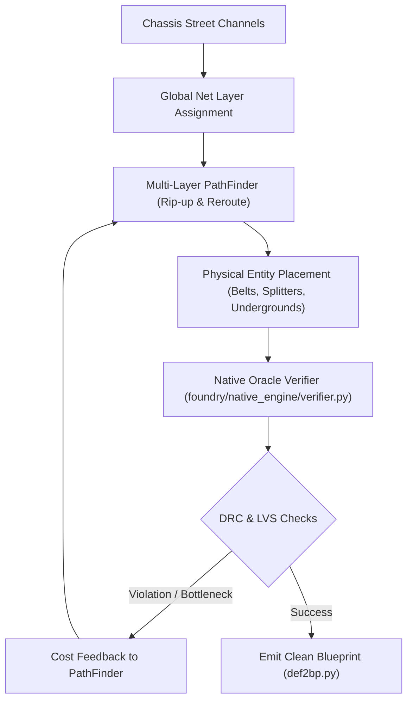

# Native Simulation Oracle & Router Architecture Specification

## 1. Executive Summary & Core Concept

This document specifies the **Native Simulation Oracle & Router Architecture** for [`factorilog`](../README.md).

### 1.1 The Routing Problem in Factorilog
The current routing flow in [`3_route.tcl`](../flow/3_route.tcl) uses OpenROAD TritonRoute. TritonRoute routes electrical metal tracks for integrated circuits. 

Electrical wires and Factorio logistics have incompatible physics:
1. **Directionality**: Electrical tracks conduct current in all directions. Factorio belts and pipes flow strictly in one direction.
2. **Discrete Dual Lanes**: A single transport belt tile contains two physical lanes ($Lane_0$ and $Lane_1$). Each lane holds discrete items with a spacing constraint of $0.25$ tiles ($64$ fixed-point units).
3. **Side-Loading and Merging**: A T-junction connects electrical nets cleanly. In Factorio, a T-junction feeds only one lane. It blocks the other lane and creates backpressure.
4. **Commodity Contamination**: Electrical nets carry voltage signals. Belts carry heterogeneous items. An illegal physical merge permanently contaminates downstream production machines.
5. **Fluid Segments**: Factorio 2.0 pipes form continuous fluid segments with uniform pressure, not resistive networks.

The current workaround in `foundry/jumper.py` attempts to post-process electrical wires into belts by inserting underground jumpers. This process creates crossed lines, backwards belts, and throughput deadlocks. The manual checks in [`belt_drc.py`](../foundry/belt_drc.py) cannot verify whether items actually flow through the network.

### 1.2 The Native Oracle Solution
Instead of approximating Factorio simulation with manual heuristics, this architecture uses the user-supplied `$HOME/.steam/steam/steamapps/common/Factorio/bin/x64_/factorio` executable directly as a **Native Physical Oracle**:

```
+--------------------------+     +--------------------------+
|  Dual-Lane Maze Router   | --> | Physical Blueprint Graph |
+--------------------------+     +--------------------------+
                                               |
                                               v
                                 +--------------------------+
                                 |  Native Factorio Oracle  |
                                 |  - dlopen(factorio)      |
                                 |  - Step TransportLine    |
                                 |  - Step FluidBuffer      |
                                 +--------------------------+
                                               |
                     +-------------------------+-------------------------+
                     v                                                   v
          [All Items Delivered?]                                [Contamination?]
          YES: Blueprint Approved                                YES: LVS Violation Flagged
```

---

## 2. Native Dynamic Library Integration

### 2.1 ELF PIE Transformation
The Factorio Linux binary is an unstripped Position Independent Executable (`ET_DYN`). Standard `dlopen` rejects PIE binaries because of the `PT_INTERP` header and the `DF_1_PIE` dynamic tag in `DT_FLAGS_1`.

The loader in [`engine.py`](../foundry/native_engine/engine.py) prepares the binary:
1. Copies the binary to a cache directory (`factorio_lib.so`).
2. Changes the `PT_INTERP` program header type from `0x03` to `0x00` (`PT_NULL`).
3. Clears the `DF_1_PIE` bit (`0x08000000`) in `DT_FLAGS_1`.
4. Loads `libsteam_api.so` into global scope.
5. Invokes `dlopen("factorio_lib.so", RTLD_LAZY | RTLD_GLOBAL)`.
6. Resolves runtime base address from `/proc/self/maps`.

### 2.2 Repeatable Symbol Discovery Across Releases
When game updates occur, memory addresses change. The system discovers offsets automatically:

| Routine | Demangled Pattern | Target Mechanism |
| :--- | :--- | :--- |
| `TransportLine::update` | `^TransportLine::update\(MapTick, unsigned int\)$` | Belt tick processing & propagation |
| `TransportLine::move` | `^TransportLine::move\(` | Item spacing ($0.25$ tiles) & transfers |
| `TransportLine::unsquash` | `^TransportLine::unsquash\(` | Deque item spacing restoration |
| `SplitterLogic::resolveSplitting` | `^SplitterLogic::resolveSplitting\(` | 2x2 lane balancing & priority filtering |
| `FluidBuffer::getFlowRate` | `^FluidBuffer::getFlowRate\(` | 24-bit fixed point flow rate calculation |
| `FluidSegmentManager::buildNewSegment` | `^FluidSegmentManager::buildNewSegment\(` | Factorio 2.0 pipe segment grouping |

Fallback discovery uses instruction signatures:
- Spacing constant `0x40` (64 fixed point units = 0.25 tiles).
- Fluid flow multiplier `0.80` and threshold `0x199999` (0.1 units).
- Fixed-point float conversion factor `5.9604644775390625e-08` ($2^{-24}$).

---

### 3. Physical Model: 3D Multi-Layer Dual-Lane Grid

### 3.1 The 3D Multi-Layer State Space
The router operates on a directed 5-dimensional graph:
$$(x, y, z, h, l)$$

The state variables follow these definitions:
- $x, y \in \mathbb{Z}$: 2D surface tile coordinates.
- $z \in \mathcal{Z}$: Discrete physical routing layer.
  - $z = 0$: Surface layer. Hosts transport belts, curved belts, splitters, pipes, and underground hoods.
  - $z \in \{1, \dots, N_{\text{belt}}\}$: Subterranean belt layers. Each belt prototype tier occupies one independent discrete layer.
  - $z \in \{N_{\text{belt}} + 1, \dots, N_{\text{belt}} + M_{\text{pipe}}\}$: Subterranean pipe layers. Each pipe-to-ground prototype tier occupies one independent discrete layer.
- $h \in \{0, 4, 8, 12\}$: Direction heading (North, East, South, West).
- $l \in \{\text{Left}, \text{Right}, \text{Both}\}$: Lane selection for transport belts. Pipes use $\emptyset$.

### 3.2 Discrete Layer Physics and Subterranean Weaving
Underground routing provides independent physical layers.
1. **Tier Isolation**:
   An underground entrance pairs only with an underground exit of the identical prototype tier.
2. **Transparent Crossing**:
   Nets on different layers ($z_a \ne z_b$) cross without collision.
3. **Same-Tier Collision**:
   Nets on the same subterranean layer ($z_a = z_b$) cannot share or intersect subterranean tiles.
4. **Intervening Obstacles**:
   An intervening hood of the same tier blocks an underground connection. Intervening hoods of different tiers are transparent.
5. **Dynamic Spans**:
   Maximum underground spans $L_{\text{max}}(z)$ load dynamically from game prototype data (`max_distance` and `max_underground_distance`).

### 3.3 The Dual-Lane Belt Model
Each surface belt tile at position $(x, y)$ contains two independent lanes:
- $Node_{Left}(x, y, h)$
- $Node_{Right}(x, y, h)$

Each lane maintains:
- Item deque: Fixed-point positions with 256 units per tile.
- Spacing constraint: Minimum 64 units between items.
- Capacity: Maximum 4 items per tile per lane (8 items per tile total).
- Dual-lane packing: Two compatible single-lane nets can share one belt track to reduce area.

```
                      +---------------+
                      |   Lane Left   | ----> [Flow Direction]
  Belt Tile (x, y)    +---------------+
                      |   Lane Right  | ----> [Flow Direction]
                      +---------------+
```

### 3.4 Canonical Routing Transitions
The router traverses the graph with six canonical moves:

1. **Surface Straight**:
   Advance one tile along heading $h$ on layer $z = 0$.
   $$(x, y, 0, h, l) \longrightarrow (x + \Delta x_h, y + \Delta y_h, 0, h, l)$$

2. **Surface Turn**:
   Rotate heading by $\pm 90^\circ$ on layer $z = 0$:
   - Inner lane arc length: $0.785$ tiles.
   - Outer lane arc length: $1.215$ tiles.
   - Items remain on their respective lanes during turns.

3. **Underground Dive**:
   Place an entrance hood on layer $z = 0$. Transition to subterranean layer $z_{\text{tier}}$.
   $$(x, y, 0, h, l) \longrightarrow (x, y, z_{\text{tier}}, h, l)$$

4. **Subterranean Leap**:
   Traverse $k$ tiles underground on layer $z_{\text{tier}}$. The span satisfies $1 \le k \le L_{\text{max}}(z_{\text{tier}})$.
   $$(x, y, z_{\text{tier}}, h, l) \longrightarrow (x + k \Delta x_h, y + k \Delta y_h, z_{\text{tier}}, h, l)$$

5. **Underground Surface**:
   Place an exit hood on layer $z = 0$. Return from layer $z_{\text{tier}}$.
   $$(x', y', z_{\text{tier}}, h, l) \longrightarrow (x', y', 0, h, l)$$

6. **Splitter 2x2 Transition**:
   Combine, balance, or filter items across two adjacent belt tracks using native splitter logic.

---

## 4. Dual-Lane Maze Router & Verification Architecture



### 4.1 Phase 1: Global Channel Assignment
Assigns nets to street channels defined in [`chassis_layout_architecture.md`](chassis_layout_architecture.md). Orders nets to reduce crossings.

### 4.2 Phase 2: Multi-Layer Negotiated Congestion Router (PathFinder)
Replaces TritonRoute with a negotiated congestion router across the 3D multi-layer graph:

1. **Iterative Congestion Cost Formulation**:
   Calculate the cost of node $n$ in iteration $k$:
   $$c_n^{(k)} = (b_n + h_n^{(k)}) \cdot p_n^{(k)}$$
   - $b_n$: Base traversal cost. Includes tile length, turn penalty $C_{\text{turn}}$, hood cost $C_{\text{hood}}$, and tier upgrade cost $C_{\text{tier}}$.
   - $h_n^{(k)} = h_n^{(k-1)} + \beta \cdot \max(0, \text{occupancy}(n) - \text{capacity}(n))$: Historical congestion penalty.
   - $p_n^{(k)} = 1 + \gamma \cdot \max(0, \text{occupancy}(n) - \text{capacity}(n))$: Present congestion penalty.

2. **Automatic Multi-Tier Weaving Discovery**:
   - Initial iterations route nets on layer $z = 0$.
   - Conflicting crossings generate congestion penalties on $z = 0$.
   - The router diverts one net to subterranean layer $z_{\text{yellow}}$.
   - Additional crossings on the same corridor cause congestion on $z_{\text{yellow}}$.
   - The router diverts secondary crossing nets to $z_{\text{red}}$ or $z_{\text{blue}}$.
   - The negotiated congestion algorithm discovers multi-tier weaving automatically.

3. **Dual-Lane Net Co-Routing**:
   - The router pairs compatible low-throughput single-lane nets.
   - Co-routed nets share surface belt tracks on opposite lanes ($Lane_L$ and $Lane_R$).
   - Splitters separate or merge the lanes at net endpoints.

### 4.3 Phase 3: Physical Blueprint Assembly
The router translates graph paths into concrete Factorio entities:
- Converts straight edges to transport belts or pipes.
- Converts turn nodes to curved belts.
- Converts dive and surface transitions to paired underground hoods.
- Converts merges and filters to splitters.

### 4.4 Phase 4: Closed-Loop Native Oracle Verification (DRC & LVS)
The engine validates the candidate blueprint before acceptance:
1. **Physical DRC**:
   - Verifies underground spans against dynamic prototype limits.
   - Verifies underground pairings, orientations, and blocking hoods.
   - Verifies fluid isolation across independent pipe networks.
2. **Native Simulation LVS**:
   - Injects items at source pins and runs simulation for 120 ticks.
   - Validates discrete item movement using `TransportLine::move`.
   - Validates fluid pressures using `FluidBuffer::getFlowRate`.
   - Confirms arrival of all required items at target sinks.
   - Confirms zero commodity contamination.
3. **Closed-Loop Feedback**:
   - If DRC or LVS fails, the verifier returns exact coordinate locations.
   - The router applies an infinite cost penalty to the failing nodes and reroutes.

---

## 5. Implementation Roadmap & File Layout

### Milestone 1: Native Engine Module (`foundry/native_engine/`) [Complete]
- Ported engine loader into [`foundry/native_engine/engine.py`](../foundry/native_engine/engine.py).
- Automated binary preparation and symbol resolution in [`foundry/native_engine/symbol_finder.py`](../foundry/native_engine/symbol_finder.py).
- Implemented 18 comprehensive simulation unit tests in [`test/test_native_engine.py`](../test/test_native_engine.py).

### Milestone 2: Ground-Truth LVS/DRC Testbench [Complete]
- Implemented [`NativeLayoutVerifier`](../foundry/native_engine/verifier.py) in [`foundry/native_engine/verifier.py`](../foundry/native_engine/verifier.py).
- Added dynamic prototype loading without hardcoded constants.
- Added multi-tier underground belt and pipe weaving support.
- Implemented 14 layout verification tests in [`test/test_layout_verifier.py`](../test/test_layout_verifier.py).

### Milestone 3: Dual-Lane Directed Maze Router (`foundry/router/`) [Active]
- Build `foundry/router/types.py`:
  - Graph node representations, headings, layer identifiers, and net definitions.
- Build `foundry/router/grid.py`:
  - 3D multi-layer grid with dynamic prototype layer registry and congestion tracking.
- Build `foundry/router/transitions.py`:
  - Canonical move generator for straight, bend, dive, leap, surface, and splitter transitions.
- Build `foundry/router/pathfinder.py`:
  - Multi-layer A* router with negotiated congestion (rip-up and reroute).
- Build `foundry/router/blueprint_builder.py`:
  - Translates abstract routed graphs into concrete Factorio blueprint entities.
- Build `foundry/router/maze_router.py`:
  - Top-level router orchestrator with closed-loop [`NativeLayoutVerifier`](../foundry/native_engine/verifier.py) feedback.
- Build `test/test_router.py`:
  - Unit and integration tests for multi-tier weaving, dual-lane packing, and closed-loop routing.

### Milestone 4: Flow Integration
- Integrate `foundry/router/` into [`foundry/chassis.py`](../foundry/chassis.py) and [`flow/3_route.tcl`](../flow/3_route.tcl).
- Deprecate `foundry/jumper.py`.
- Verify end-to-end blueprint generation for multi-block factory designs.
